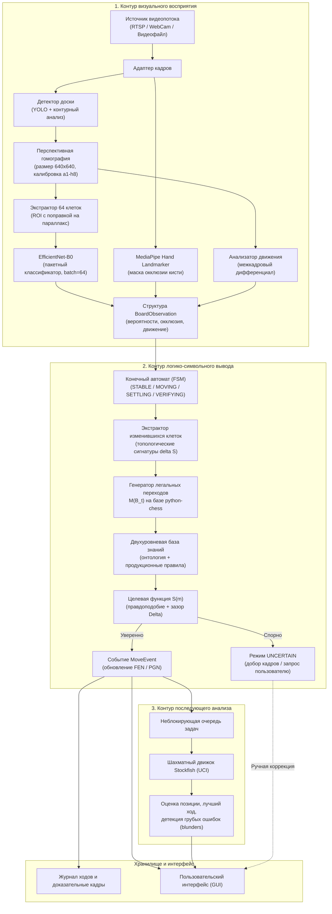

# Дорожная карта и архитектурный план разработки системы

Документ фиксирует детальную архитектуру, результаты анализа физических и оптических нюансов взаимодействия с инвентарем, методологию разработки и пошаговый план реализации с критериями приемки (Definition of Done).

---

## 1. Архитектурная модель системы

Система построена на принципах **нейросимволического ИИ (Neuro-Symbolic AI)** с разделением на три слабосвязанных контура, взаимодействующих через типизированные структуры данных.

### Контракты данных между контурами
* `BoardGeometry`: 4 вершины полигона доски, матрица гомографии $3 \times 3$, оценка качества $S_g \in [0, 1]$, ориентация доски.
* `CellObservation`: координата поля ($a1 \dots h8$), распределение вероятностей по 13 классам (пусто, 6 белых, 6 черных фигур), флаг окклюзии `occluded`.
* `BoardObservation`: матрица $8 \times 8$ наблюдений клеток, статус движения `motion_detected`, маска кисти руки, временная метка кадра.
* `MoveHypothesis`: шахматный ход (UCI/SAN), список затронутых клеток $\Delta \mathcal{S}$, комплексный балл правдоподобия $S(m)$.
* `MoveEvent`: порядковый полуход, FEN до/после хода, выполненный ход, доказательные кадры (до, после, разность), результат анализа Stockfish.

---

## 2. Предметные ограничения и физические нюансы проектирования

В ходе архитектурного проектирования выявлены и формализованы следующие ключевые аспекты физического взаимодействия:

### 2.1. Калибровка пространственной ориентации доски ($a1 \leftrightarrow h8$)
Четырёхугольник доски инвариантен к поворотам на $90^\circ$ и $180^\circ$. Для исключения зеркального или повернутого восприятия реализована трехфакторная схема:
1. **Правило FIDE о цветности угловых полей:** правое нижнее поле любого игрока всегда белое ($h1$ для белых, $a8$ для черных), что исключает ошибочный поворот на $90^\circ$ или $270^\circ$.
2. **Анализ начального материального баланса:** при старте партии анализируются горизонтали 1–2 (белые фигуры) и 7–8 (черные фигуры), что разрешает поворот на $180^\circ$.
3. **Сессионный конфигурационный параметр:** принудительная фиксация стороны оператора при старте партии с произвольной позиции.

### 2.2. Компенсация 3D-высоты фигур и перспективного параллакса
При съемке под углом $\theta < 90^\circ$ (эксплуатационный диапазон $\theta \in [60^\circ, 85^\circ]$) высокие фигуры проецируются за пределы плоской границы клетки и частично перекрывают поля вышестоящих горизонталей.
* **Решение:** адаптивное вертикальное расширение области интереса (Cell ROI) с коэффициентом $\alpha_{\text{height}} \approx 1{,}25$ вверх вдоль луча перспективы; приоритизация классификации зоны контакта основания фигуры с поверхностью доски.

### 2.3. Динамические тени рук и временной дебаунсинг
При физическом ходе рука отбрасывает динамические тени при комнатном освещении, вызывая ложные всплески в межкадровой разности. После отпускания фигуры наблюдается затухающее колебание (100–300 мс).
* **Решение:** в конечный автомат FSM введен защитный интервал дебаунсинга $\Delta t_{\text{settle}} \in [0{,}5; 1{,}0]$~с (15–30 кадров при 30 FPS). Переход в фазу валидации `VERIFYING` допускается только при полном отсутствии кисти в кадре и стабильности оптической картины на протяжении всего окна $\Delta t_{\text{settle}}$.

### 2.4. Топологические сигнатуры изменившихся клеток
Сопоставление множества изменившихся клеток $\Delta \mathcal{S}$ с легальными ходами $M(B_t)$ опирается на строгие структурные шаблоны:
* **Стандартный ход или взятие:** $|\Delta \mathcal{S}| = 2$ ($s_{\text{from}}$ освобождается, $s_{\text{to}}$ занимается).
* **Рокировка (двойной ход):** $|\Delta \mathcal{S}| = 4$ (одновременное перемещение короля и ладьи: `e1-g1-h1-f1` или `e1-c1-a1-d1`).
* **Взятие на проходе (En Passant):** $|\Delta \mathcal{S}| = 3$ (пешка перемещается с $s_{\text{from}}$ на $s_{\text{to}}$, сбитая пешка противника исчезает с $s_{\text{captured}}$ той же горизонтали).
* **Превращение пешки (Promotion):** $|\Delta \mathcal{S}| = 2$ со сменой класса фигуры с пешки на ферзя, ладью, слона или коня.

### 2.5. Комплексная целевая функция доверия $S(m)$
Выбор наилучшего кандидата осуществляется максимизацией взвешенной функции:
$$S(m) = w_v S_v(m) + w_t S_t(m) + w_g S_g(m) - w_o P_o(m)$$
* $S_v(m)$ — логарифмическое правдоподобие согласованности вероятностей нейросети с гипотезой хода;
* $S_t(m)$ — стабильность во времени на протяжении интервала $\Delta t_{\text{settle}}$;
* $S_g(m)$ — мера качества матрицы перспективной гомографии;
* $P_o(m)$ — штраф за окклюзию ключевых клеток кистью;
* Правило надежной фиксации: $S(m_1) - S(m_2) \ge \Delta$. При недостатке зазора уверенности решение переводится в статус `UNCERTAIN`.

### 2.6. Двухуровневая база знаний
* **Декларативный уровень (онтология):** таксономия понятий, цветность клеток $c(f, r) = (f+r) \pmod 2$, материальные инварианты (единственность королей, инвариант однопольности слонов до превращения).
* **Продукционный уровень:** правила вида «ЕСЛИ ... ТО ...» для разрешения противоречий (дедуктивное доопределение превращения пешки, отсечение визуальных гипотез под связкой короля).

---

## 3. Методология разработки

Для проекта принята **Итеративно-инкрементная модель разработки (Iterative-Incremental / Tracer Bullet) с элементами Kanban**:

* **Отказ от каскадной модели (Waterfall):** в задачах компьютерного зрения каскадная схема несет критические риски, поскольку погрешности классификации и гомографии вскрываются только на финальных этапах сборки.
* **Принцип трассирующей пули (Tracer Bullet):** разработка ведется вертикальными сквозными срезами. Начиная с базового сценария, каждый инкремент проходит полный путь от видеокадра до формирования FEN/PGN и обрастает устойчивостью к физическим помехам реального мира.
* **Управление рисками производительности:** если пакетный инференс 64 клеток через EfficientNet-B0 на CPU покажет задержку $>100$ мс, архитектура позволяет прозрачно заменить бэкенд на легковесный ResNet-18 или объединенный детектор без изменения интерфейсов символьного контура.

---

## 4. Этапы реализации и критерии приемки (WBS & DoD)

| Этап | Название этапа | Основной фокус | Ключевой результат (Definition of Done) | Статус |
| :---: | :--- | :--- | :--- | :---: |
| **0** | **Инфраструктура и бенчмарк** | Настройка среды, бенчмарк-видео, аннотации ходов | Готовый тестовый стенд для воспроизведения видео и проверки точности (40 тестов) | **Готово** (`STAGE/0`) |
| **1** | **Геометрия и нормализация** | Детекция доски, гомография, ориентация $a1 \dots h8$ | Стабильный кроп доски $640 \times 640$ с корректной нумерацией клеток | В планах (`STAGE/1`) |
| **2** | **Динамика, руки и автомат FSM** | MediaPipe Hand Landmarker, дебаунсинг теней, FSM | Точный триггер момента завершения хода без ложных срабатываний от рук | В планах (`STAGE/2`) |
| **3** | **Классификатор клеток** | Пакетный инференс (64 клетки), вероятности 13 классов | Модуль формирует структуру `BoardObservation` $\le 100$ мс | В планах (`STAGE/3`) |
| **4** | **Нейросимвольный решатель** | $M(B_t)$, фильтр сигнатур, $S(m)$, специальные ходы | Сквозная регистрация всей партии в PGN без сбоев на рокировках и взятиях | В планах (`STAGE/4`) |
| **5** | **Stockfish и отказоустойчивость** | Асинхронная очередь UCI, оценка ходов, восстановление | Фоновый расчет blunder-оценок и обработка ветки `UNCERTAIN` | В планах (`STAGE/5`) |
| **6** | **UI и финализация ПЗ** | Графический интерфейс, ручная коррекция, оформление | Законченное работающее приложение + скомпилированная ПЗ по ГОСТ | В планах (`STAGE/6`) |

### Детальное содержание этапов

#### Этап 0. Инфраструктура, структура проекта и бенчмарк-данные
* **Задачи:**
  * Развертывание каталогов проекта (`src/`, `tests/`, `configs/`).
  * Фиксация окружения и зависимостей (`opencv-python`, `torch`, `torchvision`, `mediapipe`, `python-chess`).
  * Подготовка эталонных записей партий с размеченными PGN (идеальный ракурс, быстрые руки с тенями, рокировка/взятие на проходе/превращение).
* **DoD:** Конфигурации и виртуальный стенд воспроизводят тестовые файлы и выполняют сверку ходов с эталоном.

#### Этап 1. Локализация доски, гомография и ориентация (Vision Preprocessing)
* **Задачи:**
  * Грубая локализация доски (YOLO / контурный детектор OpenCV).
  * Вычисление матрицы гомографии и приведение поля к размеру $640 \times 640$.
  * Калибровка ориентации полей ($a1 \leftrightarrow h8$) по цвету угловых полей и начальной расстановке.
  * Нарезка сетки 64 клеток с поправкой на вертикальный параллакс высоких фигур ($\alpha_{\text{height}}$).
* **DoD:** Для тестового видеопотока стабильно формируется нормализованная доска $8 \times 8$ с корректными шахматными координатами клеток (погрешность углов $\le 2$ пикселей).

#### Этап 2. Анализ динамики: детекция движения, рук и конечный автомат (FSM)
* **Задачи:**
  * Интеграция `MediaPipe Hand Landmarker` для построения полигональной маски окклюзии.
  * Детектор межкадрового движения (межкадровая разность в нормализованном пространстве).
  * Реализация конечного автомата FSM (`STABLE` $\to$ `MOVING` $\to$ `SETTLING` $\to$ `VERIFYING` $\to$ `UNCERTAIN`).
  * Реализация окна дебаунсинга $\Delta t_{\text{settle}} \in [0{,}5; 1{,}0]$~с для нейтрализации оптических теней.
* **DoD:** Автомат безошибочно изолирует фазы движения руки и затухания теней, выдавая сигнал на распознавание только в статичном состоянии.

#### Этап 3. Нейросетевая классификация содержимого клеток
* **Задачи:**
  * Подготовка модели классификации клеток (EfficientNet-B0 с многоголовым выходом или единый классификатор на 13 классов).
  * Оптимизация пакетного инференса (Batch size = 64) для минимизации задержки на CPU/GPU.
  * Формирование промежуточной структуры `BoardObservation` с матрицами вероятностей $P(C_{ij})$.
* **DoD:** Функция принимает нормализованную доску и возвращает структуру `BoardObservation` за время $\le 100$ мс.

#### Этап 4. Нейросимвольный решатель ходов и ведение партии
* **Задачи:**
  * Локализация изменившихся клеток $\Delta \mathcal{S}$ по пороговой разности наблюдений.
  * Генерация допустимых ходов $M(B_t)$ через `python-chess`.
  * Валидация по топологическим сигнатурам: обычные ходы ($|\Delta \mathcal{S}| = 2$), рокировка ($|\Delta \mathcal{S}| = 4$), взятие на проходе ($|\Delta \mathcal{S}| = 3$), превращение пешки ($|\Delta \mathcal{S}| = 2$).
  * Расчет целевой функции правдоподобия $S(m)$ и проверка порога уверенности $\Delta$.
  * Атомарная фиксация `MoveEvent` (обновление FEN, PGN, сохранение кадров-доказательств).
* **DoD:** Сквозная безошибочная запись тестовой партии из видеофайла во внутреннюю нотацию PGN без участия оператора.

#### Этап 5. Аналитический контур (Stockfish) и отказоустойчивость
* **Задачи:**
  * Асинхронная очередь задач к процессу Stockfish (протокол UCI).
  * Расчет численной оценки позиции (centipawns/mate), вычисление лучшего продолжения и маркировка ошибок (blunders).
  * Реализация ветви восстановления при $S(m_1) - S(m_2) < \Delta$: сохранение состояния `UNCERTAIN`, локальный добор кадров и локализация спорного поля.
* **DoD:** Анализ Stockfish выполняется в фоне без снижения FPS видеопотока; при возникновении неоднозначности система корректно указывает спорную область.

#### Этап 6. Пользовательский интерфейс и финализация пояснительной записки
* **Задачи:**
  * Разработка интерфейса пользователя: окно видеопотока с наложением сетки, виртуальная 2D-доска, список ходов в нотации SAN, график преимущества Stockfish.
  * Диалоговое окно ручного разрешения спорных ситуаций (выбор хода из кандидатов при `UNCERTAIN`).
  * Заполнение раздела [sec_development.tex](explanatory%20note/sections/sec_development.tex) в пояснительной записке на основе фактического кода.
  * Проведение контрольных тестов и расчет точностных метрик (точность детекции доски IoU, точность распознавания ходов %, средняя задержка).
* **DoD:** Полностью рабочий демонстрационный прототип и скомпилированная пояснительная записка по ГОСТ.
