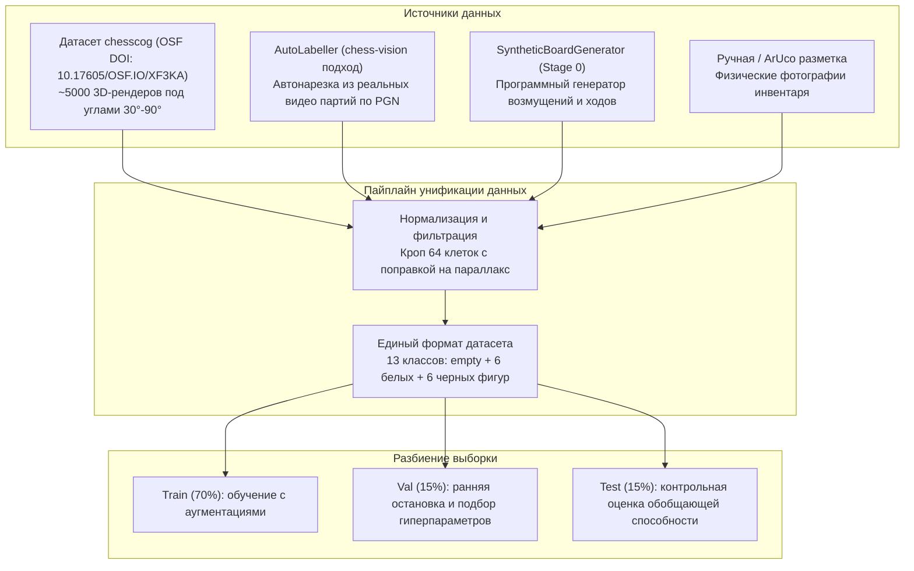
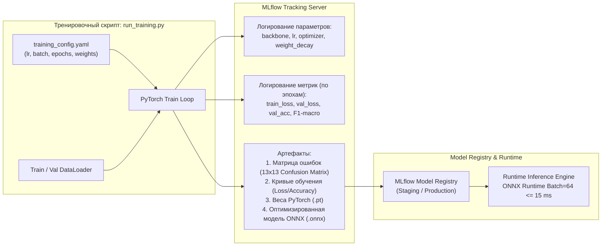

# MLOps, Пайплайн Данных и Стратегии Обучения Моделей

**Назначение документа:** Формализация архитектуры машинного обучения, пайплайна сбора и подготовки данных, доменных аугментаций, интеграции с MLflow, стратегий трансферного обучения (Transfer Learning) и высокопроизводительного рантайм-инференса для системы автоматической регистрации шахматных партий.

Документ обобщает исследовательские наработки проекта, научные результаты статьи *«Determining Chess Game State From an Image»* (Wölflein & Arandjelović, 2021, репозиторий `chesscog`), практические решения репозитория `chess-vision` (mulac) и проектные решения пояснительной записки.

---

## 1. Источники данных и структура датасетов

Для обучения и валидации нейросетевых моделей системы формируется комбинированный многоисточниковый датасет:



### 1.1. Таксономия классов (13 классов)
Все классификаторы обучаются на едином алфавите классов:
1. `empty` — пустое поле доски;
2. Белые фигуры (`wP`, `wN`, `wB`, `wR`, `wQ`, `wK`);
3. Черные фигуры (`bP`, `bN`, `bB`, `bR`, `bQ`, `bK`).

### 1.2. Механизм Auto-Labelling (нарезка из видео по PGN)
Для быстрого сбора тысяч размеченных изображений реальных фигур без ручного труда реализуется модуль `src/ml/auto_labeller.py` (по мотивам `chess-vision/label.py`):
* **Входные данные:** видеозапись партии (`.mp4`) и соответствующая нотация (`.pgn`).
* **Алгоритм работы:**
  1. На начальном статическом кадре ($t_0$) известны позиции всех 64 полей (стандартная начальная расстановка дает 32 занятых поля и 32 пустых).
  2. Для каждого зарегистрированного полухода $m = (s_{\text{from}}, s_{\text{to}})$:
     - Поле $s_{\text{from}}$ переходит в класс `empty`;
     - Поле $s_{\text{to}}$ получает класс перемещенной фигуры (с учетом превращения пешки);
     - При взятии на проходе дополнительно освобождается сбитая пешка;
     - При рокировке обновляются 4 поля.
* **Результат:** 1 час видеозаписи матча из 60 ходов автоматически генерирует свыше $60 \times 2 \times 30 = 3600$ размеченных снимков клеток в условиях реального клубного освещения.

---

## 2. Физико-ориентированные доменные аугментации

В отличие от стандартных задач ImageNet, фигуры на шахматной доске обладают жесткой физической привязкой: **основание фигуры всегда неподвижно контактирует с плоскостью клетки, а вершина отклоняется из-за наклона камеры**. 

Обычные случайные повороты и стандартные сдвиги разрушают пространственную топологию. В модуле `src/ml/transforms.py` реализуются специализированные аугментации (развитие идей `chesscog`):

```python
class AnchoredShear:
    """Сдвиг (Shear) с закрепленным основанием клетки.
    
    Сдвигает только верхнюю часть изображения клетки, оставляя нижнюю границу
    неподвижной. Имитирует перспективный наклон фигур при ракурсах 60°-85°.
    """
    def __init__(self, max_shear: float = 0.25):
        self.max_shear = max_shear

    def __call__(self, img: Image.Image) -> Image.Image:
        shear_val = np.random.uniform(-self.max_shear, self.max_shear)
        # Flip -> affine transform -> flip back (фиксирует нижнюю кромку)
        img_flipped = ImageOps.flip(img)
        img_transformed = img_flipped.transform(
            img.size, Image.AFFINE, (1, -shear_val, 0, 0, 1, 0)
        )
        return ImageOps.flip(img_transformed)

class AnchoredScale:
    """Масштабирование с опорой на нижний край клетки.
    
    Варьирует видимую высоту фигуры при сохранении точки контакта с доской.
    """
    def __init__(self, scale_range: tuple[float, float] = (0.85, 1.25)):
        self.scale_range = scale_range

    def __call__(self, img: Image.Image) -> Image.Image:
        scale = np.random.uniform(*self.scale_range)
        w, h = img.size
        new_h = int(round(h * scale))
        resized = img.resize((w, new_h))
        return resized.transform(
            (w, h), Image.AFFINE, (1, 0, 0, 0, 1, new_h - h)
        )
```

### Дополнительные аугментации:
* **ColorJitter & Contrast:** моделирование перепадов естественного освещения и теплых/холодных ламп накаливания.
* **Shadow Injection:** наложение мягких полупрозрачных градиентных эллипсов (имитация падающих теней от рук игроков).
* **Gaussian Blur & Sensor Noise:** моделирование расфокусировки и шума недорогих USB веб-камер.

---

## 3. Архитектура нейросетевых моделей

Проектируется двухуровневая поддержка бэкбонов:

### 3.1. Базовая архитектура: Multi-Task vs Single-Head 13-Class
1. **Single-Head (Основная модель):**
   - Бэкбон: **`EfficientNet-B0`** (4.0M параметров, высокая точность на Flops) или **`ResNet-18`** (11.2M параметров).
   - Выход: 13 логитов, функция потерь — взвешенная кросс-энтропия $\mathcal{L}_{\text{CE}}$ с повышенным штрафом за путаницу белых и черных фигур.
2. **Multi-Head (Альтернативная схема из `chess-vision`):**
   - Голова 1: `occupancy_head` ($p_{\text{occ}} \in [0, 1]$);
   - Голова 2: `color_head` ($p_{\text{color}} \in \{0, 1\}$);
   - Голова 3: `piece_type_head` (6 классов: P, N, B, R, Q, K);
   - Комплексный лосс: $\mathcal{L} = w_{\text{occ}} \mathcal{L}_{\text{occ}} + w_{\text{color}} \mathcal{L}_{\text{color}} + w_{\text{type}} \mathcal{L}_{\text{type}}$.

### 3.2. Стратегии обучения (Training Strategies)

```text
┌─────────────────────────────────────────────────────────────────────────────┐
│                       СТРАТЕГИИ ОБУЧЕНИЯ МОДЕЛЕЙ                            │
├────────────────────────────────┬────────────────────────────────────────────┤
│ Стратегия А: Zero-Shot         │ Использование предобученных весов chesscog │
│ (Мгновенный запуск)            │ (ResNet/Inception). Позволяет тестировать  │
│                                │ конвейер до начала собственного обучения.  │
├────────────────────────────────┼────────────────────────────────────────────┤
│ Стратегия Б: Transfer Learning │ Загрузка весов ImageNet для EfficientNet.  │
│ (Основное обучение)            │ Заморозка первых блоков (Feature Extractor)│
│                                │ -> обучение классификационной головы       │
│                                │ -> fine-tuning верхних 30% слоев на 5k+ датасете.│
├────────────────────────────────┼────────────────────────────────────────────┤
│ Стратегия В: Few-Shot Adapta-  │ Калибровка под конкретный инвентарь        │
│ tion (Калибровка на месте)     │ пользователя по 2 кадрам (пустая доска     │
│                                │ + начальная позиция) по методу Wölflein.   │
└────────────────────────────────┴────────────────────────────────────────────┘
```

---

## 4. Архитектура MLOps и интеграция с MLflow

Для воспроизводимости экспериментов, отслеживания метрик и версионирования моделей внедряется платформа **MLflow**:



### 4.1. Логируемые параметры и метрики
* **Параметры:** `backbone_type`, `learning_rate`, `batch_size`, `optimizer`, `scheduler`, `parallax_alpha`, `loss_type`, `seed`.
* **Метрики валидации:**
  - `accuracy_overall` — общая точность по всем 64 клеткам;
  - `occupancy_accuracy` — точность бинарного разделения (пусто/занято);
  - `color_accuracy` — точность классификации стороны (White/Black);
  - `macro_f1_score` — взвешенное гармоническое среднее по 13 классам;
  - `inference_latency_batch64_ms` — аппаратная скорость прогона 64 клеток на CPU.
* **Артефакты:**
  - Тепловая карта матрицы ошибок (`confusion_matrix.png`);
  - Экспортированная модель `model.onnx` с метаданными.

---

## 5. Высокопроизводительный рантайм-инференс (ONNX Runtime)

В соответствии с требованиями пояснительной записки ([ПЗ, разд. 2.4.2](file:///home/ectrald/Repos/Chess-game-recording-system/explanatory%20note/sections/sec_designing.tex#L160-L170)), инференс 64 клеток должен укладываться в $\le 100$ мс на стандартном CPU, чтобы не приводить к пропуску кадров видеопотока.

* **Решение:** Экспорт обученной модели PyTorch в формат **ONNX (Open Neural Network Exchange)** с оптимизацией графа вычислений:
  ```python
  torch.onnx.export(
      model,
      dummy_input, # shape: (64, 3, 112, 112)
      "weights/piece_classifier.onnx",
      input_names=["cell_images"],
      output_names=["probabilities"],
      dynamic_axes={"cell_images": {0: "batch_size"}},
      opset_version=17
  )
  ```
* **Ожидаемое время инференса:** Пакетный прогон $64 \times (3, 112, 112)$ через ONNX Runtime с поддержкой AVX2/AVX-512 на CPU составляет **$10 - 20$ мс**, что с 5-кратным запасом удовлетворяет требованиям реального времени.

---

## 6. План внедрения MLOps по этапам разработки

| Этап | Задачи по машинному обучению и данным | Артефакты этапа |
| :--- | :--- | :--- |
| **Этап 1 (`STAGE/1`)** | Внедрение алгоритмов уточнения сетки (Hough/RANSAC) и ArUco-калибровки для сбора геометрии. | Детектор углов с погрешностью $\le 2$ px; нарезка 64 клеток с поправкой $\alpha_{\text{height}}$. |
| **Этап 2 (`STAGE/2`)** | Реализация `AutoLabeller` для автоматической нарезки датасетов из видеозаписей партий с PGN. | Утилита `scripts/auto_label_from_video.py`; датасет из 10 000+ реальных клеток. |
| **Этап 3 (`STAGE/3`)** | Развертывание контура обучения PyTorch + MLflow; доменные аугментации (`Shear`, `Scale`); обучение и экспорт ONNX. | Веса моделей в `data/weights/`; MLflow run с $F_1 \ge 0.95$; инференс $\le 20$ мс. |
| **Этап 4 (`STAGE/4`)** | Интеграция вероятностного вектора нейросети в целевую функцию правдоподобия $S(m)$. | Сквозная детекция ходов с точностью $\ge 95\%$. |
