# 02. Архитектура системы

## 1. Архитектурный стиль

Рекомендуется модульный монолит с тремя логическими контурами и единым процессом регистрации. Для курсового/студенческого объёма микросервисы добавили бы сетевые отказы, сериализацию и эксплуатационную сложность без очевидной выгоды. Компоненты отделяются интерфейсами и контрактами данных, а не отдельными процессами.

Контуры:

1. **Vision** — видеовход, геометрия, клетки, hand/occlusion, движение и вероятностные предсказания.
2. **Reasoning / Game State** — временная стабилизация, генерация legal move candidates, scoring, подтверждение и журналирование партии.
3. **Analysis** — асинхронный Stockfish и отчёты. Он подписывается на confirmed `MoveEvent`, но не управляет official board state.

Внешний слой — операторский UI/CLI, конфигурация и persistence.

## 2. Целевая компонентная схема

```mermaid
flowchart LR
  CAM[Camera / Video File] --> VA[Video Adapter]
  SYN[Synthetic Generator] --> VA
  VA --> BUF[Bounded Frame Queue]
  BUF --> BOARD[Board Localizer]
  BOARD --> GEO[Geometry / Homography]
  GEO --> CELLS[Cell ROI Extractor]
  BUF --> HAND[Hand/Occlusion Detector]
  GEO --> MOTION[Motion Detector]
  CELLS --> CLS[Piece Classifier]
  HAND --> OBS[Observation Builder]
  MOTION --> OBS
  CLS --> OBS
  GEO --> OBS
  OBS --> FSM[Temporal State Machine]
  FSM --> DIFF[State Difference]
  DIFF --> GEN[Legal Move Candidate Generator]
  GEN --> SCORE[Visual/Temporal Move Scorer]
  SCORE --> DEC{Acceptance Gate}
  DEC -->|accepted| COMMIT[Atomic Game State Commit]
  DEC -->|uncertain| REC[Recovery / User Confirmation]
  REC --> FSM
  COMMIT --> STORE[PGN + Event Log + Evidence]
  COMMIT --> Q[Bounded Analysis Queue]
  Q --> SF[Stockfish UCI Worker]
  SF --> REPORT[Analysis Result]
  STORE --> UI[User Interface]
  REPORT --> UI
  REC --> UI
```



Диаграмма показывает логические компоненты; реализация может выполняться одним Python-процессом. Очереди необходимы между захватом и тяжёлыми стадиями, чтобы медленный inference не блокировал чтение камеры.

## 3. Назначение компонентов и технологии

| Компонент | Рекомендуемая реализация | Роль и границы |
|---|---|---|
| Video Adapter | Существующий `BaseVideoAdapter` + OpenCV | Возвращает Frame/EOF/error с timestamp. Не знает о шахматах. |
| Board Localizer | Двухстадийный гибрид (Coarse-to-Fine): YOLO (YOLOv8n-board) для грубого ROI доски на зашумлённой сцене + OpenCV (Hough/RANSAC/Contour) для субпиксельного нахождения 4 углов; ArUco и ручные углы как калибровочный fallback | Изолирует область доски из сложного фона комнаты и точно находит четыре угла сетки с оценкой качества $S_g$ (ПЗ разд. 2.4.1). |
| Geometry | OpenCV `getPerspectiveTransform`/`findHomography`, `warpPerspective` | Приводит плоскость доски к квадратному полю 640×640. Не устраняет 3D-параллакс от высоты фигур. |
| Orientation Resolver | Трёхфакторный резолвер: цветность углов FIDE ($90^\circ/270^\circ$) + анализ распределения масс 1–2 и 7–8 горизонталей ($180^\circ$) + выбор пользователя | Устанавливает однозначное соответствие нормализованных углов координатам `a1`…`h8`. |
| Cell ROI Extractor | OpenCV + адаптивный вертикальный crop выше основания клетки ($\alpha_{\text{height}} \approx 1.25$) | Создаёт 64 изображения клеток с компенсацией перспективного параллакса высоких фигур. |
| Hand Detector | MediaPipe Hand Landmarker как advisory detector | Находит landmarks руки; по ним строится приближённая область перекрытия. Не распознаёт фигуры и не определяет ход. При отказе detector status=unknown, не `no hand`. |
| Motion Detector | OpenCV absdiff/threshold + morphology; optical flow — optional | Выявляет динамику на нормализованной доске. Отделяет тени/изменение экспозиции от движения насколько возможно. |
| Piece Classifier | ONNX Runtime (CPU инференс $\le 20$ мс) / PyTorch; Baseline 0 — готовые веса `chesscog` (ResNet); основная модель — EfficientNet-B0 / ResNet-18 (13 классов и multi-head варианты) | Возвращает вероятности по 64 клеткам. Оптимизированный ONNX-граф обеспечивает работу без просадки FPS. |
| Temporal FSM | Собственная конечная машина в `src/core` | Устанавливает, когда наблюдения пригодны для регистрации (STABLE / MOVING / SETTLING / VERIFYING). |
| Move Candidate Generator | `python-chess` | Генерирует только legal moves из текущей позиции. |
| Move Scorer | Собственный модуль | Оценивает visual likelihood для клеток, затронутых кандидатом, temporal consistency, geometry и occlusion: $S(m) = w_v S_v + w_t S_t + w_g S_g - w_o P_o$. |
| Acceptance / Recovery | Собственная state/decision policy | Принимает, откладывает или просит пользователя при недостатке зазора $\Delta$. |
| Game Repository | PGN + append-only JSONL + evidence directory; без БД на первой версии | Хранит события и доказательства. SQLite может быть добавлен, если нужны поиск/редактирование/мультисессии. |
| Chess Analysis | Stockfish через UCI, python-chess engine wrapper | Фоновая аналитика после commit. Не участвует в распознавании физического действия. |
| UI | Сначала CLI/простая desktop панель; PyQt6 — если нужна полноценная визуализация | Показ текущей доски, overlay, PGN, uncertain state и engine analysis. |
| Training / MLOps | PyTorch + **MLflow Tracking & Model Registry**; экспорт в ONNX | Воспроизводимое обучение, логирование параметров, поклассовых F1-метрик (13 классов), матриц ошибок и артефактов моделей. |

## 4. Потоки данных и очереди

### 4.1. Поток кадров

`VideoAdapter` отдаёт последовательность `Frame`. Для live источника применяется bounded queue. Если очередь заполнена, стратегия должна быть явной:

- для inference кадров можно пропускать промежуточные элементы, сохраняя самый свежий кадр;
- кадры вокруг движения/неоднозначности нужно сохранять как evidence;
- id и timestamp исходных кадров не перенумеровывать после пропуска;
- запись подтверждённого хода должна опираться на упорядоченные timestamps, а не на количество вызовов inference.

### 4.2. Vision observations

Слой Vision формирует `BoardObservation` только когда доска локализована. Если геометрия потеряна, лучше вернуть `VisionStatus.BOARD_NOT_FOUND/GEOMETRY_UNSTABLE`, а не синтезировать 64 неверных клетки.

### 4.3. Game state

Только `GameStateManager` имеет право обновлять официальную позицию. Vision, FSM и Stockfish не должны напрямую изменять board object. Все обновления проходят через единую функцию commit.

### 4.4. Analysis queue

После commit создаётся задача `AnalyzeMoveEvent`. Очередь ограничена. При её переполнении политика должна выбрать один из режимов: сброс повторного/старого анализа, пауза постановки задач или запись `analysis_skipped`; нельзя блокировать video capture.

## 5. MediaPipe: точная роль

MediaPipe включён только в компонент **Hand/Occlusion Detector**.

**Вход:** кадр (RGB, после преобразования из BGR), timestamp, геометрия доски.  
**Выход:** landmarks каждой обнаруженной руки, нормализованный bbox/hull, confidence, detector status.  
**Действия верхнего уровня:** преобразовать landmarks в координаты кадра/доски, сформировать polygon/convex hull, расширить его на небольшую защитную область, пересечь с полигонами 64 клеток и вычислить `occlusion_ratio`.

MediaPipe не:

- находит углы доски;
- распознаёт тип/цвет фигуры;
- определяет, куда переместили фигуру;
- решает, легален ли ход;
- подтверждает завершение хода.

При пропуске руки нельзя трактовать отсутствие landmarks как доказательство отсутствия руки. Для надежности `hand_detector_status` принимает значения `AVAILABLE`, `UNAVAILABLE`, `ERROR`, `NOT_RUN`. Если статус не `AVAILABLE`, FSM использует motion/stability и более консервативный acceptance gate. Это позволяет отключить MediaPipe, если он не помещается в CPU budget.

## 6. Двухстадийная схема локализации доски (Coarse-to-Fine: YOLO + Hough/RANSAC)

В соответствии с проектными решениями пояснительной записки ([ПЗ, разд. 2.4.1](file:///home/ectrald/Repos/Chess-game-recording-system/explanatory%20note/sections/sec_designing.tex#L141-L146)) и ROADMAP системы, задача локализации решается по двухстадийной схеме **Coarse-to-Fine**:

1. **Стадия 1 (Coarse ROI — YOLO):**
   В реальных условиях эксплуатации камера захватывает не только доску, но и окружающую сцену (стол с древесной текстурой, обои, одежду игроков, листы записи, часы). Прямой запуск детектора граней Canny на всём кадре порождает сотни паразитных линий, приводя к сбою Hough transform и расходимости RANSAC.  
   Легковесная модель семейства YOLO (YOLOv8n с одним классом `chessboard`) запускается при старте сессии и находит надёжный bounding box доски, изолируя её от фона комнаты. Повторный запуск YOLO требуется только при потере геометрии ($S_g < \tau_g$).

2. **Стадия 2 (Fine Corners — Hough + RANSAC):**
   Внутри вырезанной области интереса (Board ROI) запускается классический алгоритм геометрического анализа сетки линий (Canny + вероятностный Hough + кластеризация пересечений + RANSAC по методике `chesscog`). Он находит точные координаты четырёх физических углов доски с субпиксельной точностью.

3. **Fallback-режимы:**
   - Для синтетических тестов и чистых кадров (где доска занимает почти весь кадр) предусмотрен прямой запуск Hough/RANSAC без вызова YOLO;
   - Для стендовой лабораторной калибровки поддерживается детекция 4 маркеров ArUco;
   - Для аварийного режима предусмотрена ручная фиксация 4 углов оператором в UI.

Такое разделение сочетает устойчивость нейросетевого детектора на сложном фоне и субпиксельную геометрическую точность классического компьютерного зрения.

## 7. Роли OpenCV, PyTorch, ONNX Runtime, MediaPipe, MLflow, python-chess и Stockfish

- **OpenCV:** захват видеопотока, цветовые преобразования, Canny/Hough геометрия, перспективный варпинг 640×640, вычисление межкадровой разности и нарезка 64 клеток с поправкой $\alpha_{\text{height}}$.
- **PyTorch:** среда обучения и дообучения классификаторов клеток (Transfer Learning с ImageNet, доменные аугментации, экспорт).
- **ONNX Runtime:** основной высокоскоростной движок рантайм-инференса на CPU (пакетная обработка 64 клеток за $\le 20$ мс).
- **MLflow:** централизованный трекинг экспериментов обучения, версионирование моделей (Model Registry), логирование поклассовых F1-метрик (13 классов) и матриц ошибок.
- **MediaPipe Hand Landmarker:** только обнаружение landmarks кистей рук для построения консультативной маски окклюзии.
- **python-chess:** символьное ядро шахматных правил, генерация допустимых ходов $M(B_t)$, валидация FEN/PGN, поддержка специальных правил (рокировка, взятие на проходе, превращение).
- **Stockfish:** асинхронный шахматный анализ позиции и детекция грубых ошибок (blunders) строго после подтверждения хода.

Ни один ML-компонент не должен самостоятельно создавать official game state.

## 8. Отказоустойчивость

| Отказ/ситуация | Действие | Состояние партии |
|---|---|---|
| Камера недоступна | Повтор открытия с backoff; UI показывает ошибку | Не меняется |
| EOF видео | Нормальное завершение источника | Сохраняется |
| Потеря RTSP | `SOURCE_LOST`, ограниченные retries, запрос решения пользователя | Не меняется |
| Доска не найдена | Повтор detection, показать кадр и диагностическую маску | Не меняется |
| Геометрия нестабильна | Запрет classify/commit, повторная калибровка | Не меняется |
| Плохая ориентация | Попросить выбрать сторону/показать стартовую позицию | Не меняется |
| MediaPipe error | Отметить detector unavailable; работать консервативно | Не меняется |
| Классификатор unavailable | Статус vision degraded, ручная позиция или завершение | Не меняется |
| Нет legal candidate | Recovery pipeline, затем `UNCERTAIN` | Не меняется |
| Несколько близких кандидатов | Доп. кадры/оператор | Не меняется |
| Stockfish timeout | Пометить analysis failed, продолжать запись | Не меняется |
| Ошибка сохранения | Не публиковать commit; повторить запись/rollback временного файла | Не меняется |
| Повторный commit того же события | Проверить event_id/idempotency key | Не дублировать |

## 9. Архитектурный принцип единого писателя

Для authoritative game state назначается ровно один компонент — `GameStateManager`. Он принимает `CandidateMoveAccepted`, повторно проверяет его на legal moves, создаёт `MoveEvent`, сохраняет событие, а затем обновляет позицию. В случае ошибки записи старое состояние сохраняется. Аналитический поток читает события, но не пишет в game state.

## 10. Целевая структура исходного кода после следующих этапов

Ниже целевая структура; существующие Stage0-файлы сохраняются. Новые модули помечены как проектируемые, а не как уже существующие.

```text
src/
  core/
    datatypes.py              # Stage0: контракты; последующее усиление schema
    config.py                 # Stage0: конфигурация
    exceptions.py             # Stage0: доменные ошибки
    benchmark.py              # Stage0: расширение benchmark
    events.py                 # новые доменные события / event ids
    session.py                # состояние сессии и lifecycle
    state_machine.py          # FSM
    persistence.py            # atomic JSONL/evidence/PGN repository

  vision/
    video_adapter.py          # Stage0: сохранить интерфейс, усилить source status
    synthetic_board.py        # Stage0: synthetic tests
    board_detector.py         # новый board localization
    geometry.py               # homography, validation, orientation
    cell_extractor.py         # position-aware 64 cell crops
    hand_detector.py          # MediaPipe optional adapter
    motion_detector.py        # frame diff / optional optical flow
    observation_builder.py    # aggregation into BoardObservation

  ml/
    __init__.py
    model.py                  # EfficientNet-B0 multi-head / ResNet baseline
    preprocessing.py          # single source of train/inference preprocessing
    inference.py              # batch prediction
    model_manifest.py         # model artifact metadata and validation
    training/                 # scripts/notebooks are external to runtime package

  reasoning/
    temporal_fsm.py           # stable/moving/settling/verifying/uncertain
    candidate_generator.py    # legal move list from current board
    move_scorer.py            # visual + temporal + geometry + occlusion score
    acceptance_gate.py        # absolute threshold + top1/top2 margin
    recovery.py               # retry / request operator / replay hypotheses
    game_state.py             # single writer for authoritative chess.Board

  analysis/
    stockfish_adapter.py      # UCI wrapper
    analysis_worker.py        # bounded async queue
    classification.py         # eval delta -> heuristic label

  ui/
    app.py                    # minimal CLI/desktop entrypoint
    view_models.py            # presentation-only state
```

Tests mirror module boundaries:

```text
tests/
  unit/core/
  unit/vision/
  unit/ml/
  unit/reasoning/
  unit/analysis/
  integration/
  e2e/
  fixtures/
```

## 11. Публичные интерфейсы модулей

Сигнатуры ниже являются проектируемыми контрактами; конкретные private methods могут меняться.

### 11.1. Board localization

```python
class BoardDetector(Protocol):
    def detect(self, frame: Frame) -> BoardGeometry | DetectionFailure: ...

class GeometryProcessor:
    def validate(self, geometry: BoardGeometry, frame: Frame) -> GeometryValidation: ...
    def compute_homography(self, geometry: BoardGeometry) -> BoardGeometry: ...
    def rectify(self, frame: Frame, geometry: BoardGeometry) -> RectifiedBoard: ...

class OrientationResolver:
    def resolve(self, board: RectifiedBoard, setup: SessionSetup) -> OrientationResult: ...
```

### 11.2. Cell crops, hand and motion

```python
class CellExtractor:
    def extract(self, rectified: RectifiedBoard, orientation: BoardOrientation) -> dict[SquareName, CellCrop]: ...

class HandDetector(Protocol):
    def detect(self, frame: Frame, geometry: BoardGeometry) -> HandObservation: ...

class MotionDetector:
    def update(self, rectified: RectifiedBoard, timestamp_sec: float) -> MotionObservation: ...
```

### 11.3. Classifier

```python
class PieceClassifier(Protocol):
    def predict_batch(self, crops: list[CellCrop]) -> dict[SquareName, CellProbabilities]: ...
    def healthcheck(self) -> ModelHealth: ...
```

`predict_batch` возвращает вероятности и метаданные модели, а не только `argmax`. Все crops приводятся к одной color-space/resize/normalization версии, указанной в `model_manifest.json`.

### 11.4. Observation builder и FSM

```python
class ObservationBuilder:
    def build(self, frame: Frame, geometry: BoardGeometry,
              crops: dict[SquareName, CellCrop],
              predictions: dict[SquareName, CellProbabilities],
              hand: HandObservation,
              motion: MotionObservation) -> BoardObservation: ...

class TemporalStateMachine:
    def update(self, observation: BoardObservation) -> StateTransition: ...
    def current_state(self) -> RecordingState: ...
```

### 11.5. Candidate generator, scorer, commit

```python
class LegalMoveCandidateGenerator:
    def generate(self, current_board: chess.Board) -> list[chess.Move]: ...

class MoveScorer:
    def score(self, current_board: chess.Board,
              candidates: list[chess.Move],
              window: ObservationWindow) -> list[MoveHypothesis]: ...

class AcceptanceGate:
    def decide(self, hypotheses: list[MoveHypothesis],
               quality: ObservationQuality) -> AcceptanceDecision: ...

class GameStateManager:
    def current_position(self) -> chess.Board: ...
    def commit(self, hypothesis: MoveHypothesis, evidence: EvidenceBundle) -> MoveEvent: ...
    def correct(self, correction: OperatorCorrection) -> MoveEvent: ...
    def replay(self, events: Iterable[MoveEvent]) -> chess.Board: ...
```

### 11.6. Analysis

```python
class StockfishAdapter(Protocol):
    def analyze(self, fen: str, limit: AnalysisLimit) -> AnalysisResult: ...

class AnalysisWorker:
    def submit(self, event: MoveEvent) -> QueueResult: ...
    def shutdown(self, timeout_sec: float) -> None: ...
```

## 12. Стартовая позиция и FEN metadata

Изображение доски сообщает размещение фигур, но не всегда позволяет восстановить все шесть полей FEN:

- side to move;
- castling rights (если ладья/король уже перемещались и вернулись, это не видно по картинке);
- en-passant target square (зависит от предыдущего хода и может быть не выводим из одной статической позиции);
- halfmove/fullmove counters.

Поэтому для корректной записи партии требуется одно из следующего:

1. старт с известной начальной позиции и регистрация всей партии от начала;
2. загрузка исходного FEN/PGN пользователем;
3. явный мастер настройки текущей позиции с вводом side-to-move и castling rights;
4. восстановление из ранее записанной истории.

Не разрешать системе автоматически придумывать castling rights/side-to-move по одному кадру.
