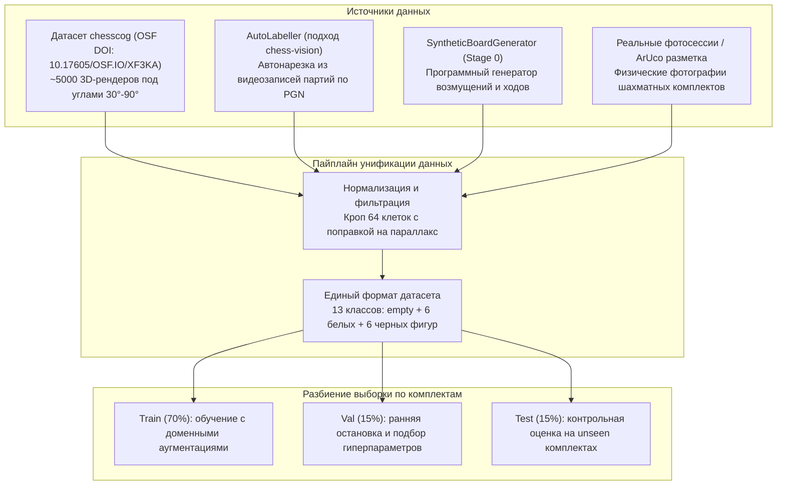
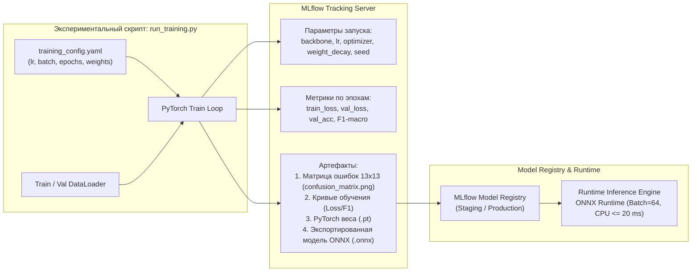

# 06. Данные, обучение моделей и MLOps при ограниченном compute

## 1. Цель ML-контура и назначение

**Назначение документа:** Формализация архитектуры машинного обучения, пайплайна сбора и подготовки данных, доменных аугментаций, интеграции с MLflow, стратегий трансферного обучения (Transfer Learning) и высокопроизводительного рантайм-инференса для системы автоматической регистрации шахматных партий.

Документ обобщает исследовательские наработки проекта, научные результаты статьи *«Determining Chess Game State From an Image»* (Wölflein & Arandjelović, 2021, репозиторий `chesscog`), практические решения репозитория `chess-vision` (mulac) и проектные решения пояснительной записки.

ML-контур обучает и поставляет классификатор содержимого клетки. Его основная задача — надёжно обобщаться на фигуры и комплекты, которых не было в обучающей выборке. Он не моделирует шахматные правила, не генерирует ход сам по себе и не заменяет temporal reasoning.

Training и runtime строго разделены: Kaggle Notebook / GPU-сервер используется для обучения и экспериментов; в приложение экспортируется только оптимизированный inference artifact (ONNX) и манифест его препроцессинга.

### 1.1. Стратегия валидации: Baseline-First и разделение этапов обучения (ADR-019)

* **Фаза 1 (Сквозная верификация рантайма):**
  Перед обучением собственных сетей вся система (захват видео, FSM, FIDE-валидация, Stockfish, Web UI) разворачивается и валидируется на **готовых открытых baseline-весах**:
  - Детектор доски: открытые предобученные веса детекции шахматных досок / углов YOLOv8 (HuggingFace / Ultralytics);
  - Распознавание фигур: готовые веса `chesscog` (`occupancy_classifier` + `piece_classifier`, Wölflein, 2021) в формате ONNX.
* **Фаза 2 (Собственное обучение и абляционные исследования):**
  Полномасштабное обучение собственных архитектур (кастомная YOLOv8 на комбинированных досках и multi-head EfficientNet-B0) проводится **после подтверждения корректности работы всего сквозного пайплайна**. Цель собственного обучения — повышение точности на нестандартных физических комплектах, адаптация к специфическим углам съёмки и экспериментальное сравнительное доказательство превосходства разрабатываемой модели над baseline в финальных бенчмарках.

## 2. Источники данных и структура датасетов

Для обучения, валидации и бенчмаркинга классификатора клеток формируется комбинированный многоисточниковый датасет:



### 2.1. Таксономия классов (13 классов)

Все классификаторы обучаются на едином каноническом алфавите классов:
1. `empty` — пустое поле доски;
2. Белые фигуры (`wP`, `wN`, `wB`, `wR`, `wQ`, `wK`);
3. Чёрные фигуры (`bP`, `bN`, `bB`, `bR`, `bQ`, `bK`).

### 2.2. Chesscog dataset (Синтетические 3D-рендеры)
Опубликованный Wölflein & Arandjelović (2021) датасет (OSF DOI: `10.17605/OSF.IO/XF3KA`), содержащий ~5000 высококачественных 3D-рендеров шахматных позиций под углами наклона камеры $30^\circ\text{--}90^\circ$ с вариациями освещения и текстур досок.
- **Назначение:** базовое синтетическое предобучение, проверка работы нарезки кропов и научный baseline.

### 2.3. Механизм AutoLabeller (нарезка из видео по PGN)
Для сбора тысяч размеченных изображений реальных фигур без ручной полигонной разметки реализуется модуль `src/ml/auto_labeller.py` (развитие концепции `chess-vision/label.py`):
- **Входные данные:** видеозапись матча (`.mp4`) и нотация партии (`.pgn`).
- **Алгоритм работы:**
  1. На начальном кадре ($t_0$) фиксируется известная стартовая позиция (32 занятых поля и 32 пустых) после верификации геометрии доски.
  2. Для каждого зарегистрированного полухода $m = (s_{\text{from}}, s_{\text{to}})$ с временной меткой:
     - поле $s_{\text{from}}$ переходит в класс `empty`;
     - поле $s_{\text{to}}$ получает класс перемещённой фигуры (с учётом превращения пешки);
     - при взятии на проходе (`en passant`) освобождается поле сбитой пешки;
     - при рокировке обновляются 4 поля (король и ладья).
  3. Кадры, в которых обнаружена рука (`hand_detected`) или зафиксировано движение (`motion_score > threshold`), исключаются из разметки, гарантируя попадание в датасет только статичных стабильных состояний.
- **Результат:** одна видеозапись партии из 60 ходов даёт свыше $60 \times 2 \times 30 \approx 3600$ размеченных снимков клеток в естественных клубных условиях.

### 2.4. Реальные фото- и видеосессии
Ключевой источник для оценки генерализации на невиданный инвентарь:
- съёмка 4–5 различных физических комплектов (дерево, пластик, турнирные Staunton);
- разные типы досок (глянцевые, матовые, виниловые, деревянные);
- вариации освещения (дневной свет, направленная лампа, тени);
- съёмка на 2–3 разные камеры (веб-камера, смартфон).

### 2.5. SyntheticBoardGenerator (Stage 0)
Программный генератор с альфа-блендингом 2D-глифов. Используется для детерминированных тестов FSM, интеграционного тестирования API и валидации координатной привязки, но не для финального обучения нейросетей физическим фигурам.

## 3. Схема датасета

```text
data/ml/
  raw/
    chesscog_render/
    real_sets/
      set_001/session_001/camera_001/
      set_002/session_002/camera_002/
  annotations/
    boards.jsonl
    move_timestamps.csv
    cells.jsonl
  processed/
    crops_v1/
      train/
      val/
      test/
  splits/
    split_by_set_v1.json
  manifests/
    dataset_manifest.json
```

Каждый crop должен иметь metadata:

```json
{
  "image": "processed/crops_v1/train/wN/sample_000123.jpg",
  "label": "wN",
  "square": "b1",
  "set_id": "set_001",
  "session_id": "session_001",
  "camera_id": "camera_001",
  "lighting_id": "light_02",
  "source_frame_id": 1824,
  "geometry_quality": 0.94,
  "occlusion_ratio": 0.0,
  "split_group": "set_001"
}
```

Классификация 13 классов с `empty` допускает генерацию пустых cell crops из размеченной позиции; избегать дисбаланса, потому что в типичной позиции empty клеток больше, чем фигур.

## 4. Разбиение train/validation/test

**Основное правило — split по chess set/session, а не по изображению.** Все crops одного исходного фото/сессии должны принадлежать одному split. Иначе модель видит практически одинаковую фигуру и освещение в train и test.

Предлагаемый initial protocol:

- `train`: 60–70% групп (sets/sessions), синтетика и часть real;
- `validation`: 15–20% отдельные группы;
- `test`: 15–20% полностью невиданные наборы/сессии.

Фактические проценты зависят от количества доступных групп. Если реальных наборов всего 3–4, использовать leave-one-set-out или grouped cross-validation, а не заявлять точную generalization по одному тестовому комплекту.

Тест должен содержать отдельные стресс-подмножества: сильная перспектива, тёмные фигуры на тёмных полях, блики, hand occlusion, motion blur, редкие классы и promotion positions.

## 5. Модель и обучение

### 5.1. Архитектура моделей: Single-Head vs Multi-Head

Проектируется двухуровневая поддержка бэкбонов:

1. **Single-Head (Основная модель):**
   - Бэкбон: **`EfficientNet-B0`** (4.0M параметров, высокая точность на FLOPs) или **`ResNet-18`** (11.2M параметров).
   - Вход: position-aware crop, приведённый к фиксированному размеру ($112 \times 112$ или $160 \times 160$).
   - Выход: 13 логитов, функция потерь — взвешенная кросс-энтропия $\mathcal{L}_{\text{CE}}$ с повышенным штрафом за путаницу белых и чёрных фигур.
2. **Multi-Head (Факторизованная схема из `chess-vision`):**
   - Голова 1: `occupancy_head` ($p_{\text{occ}} \in [0, 1]$, 2 логита);
   - Голова 2: `color_head` ($p_{\text{color}} \in \{0, 1\}$, 2 логита);
   - Голова 3: `piece_type_head` (6 классов: P, N, B, R, Q, K, 6 логитов);
   - Комплексный лосс: $\mathcal{L} = w_{\text{occ}} \mathcal{L}_{\text{occ}} + w_{\text{color}} \mathcal{L}_{\text{color}} + w_{\text{type}} \mathcal{L}_{\text{type}}$ (потери типа и цвета маскируются для пустых клеток).

### 5.2. Параметры оптимизации и baseline-архитектуры

- **Оптимизатор:** AdamW / SGD с весовым распадом (weight decay $10^{-4}$);
- **Планировщик:** ReduceLROnPlateau или CosineAnnealingLR;
- **Ранняя остановка:** EarlyStopping по validation macro F1 (patience 5–7 эпох);
- **Mixed Precision:** FP16/AMP на GPU.

Контрольные модели:
1. **Baseline 0 (chesscog pretrained):** ResNet/Inception веса Wölflein & Arandjelović (2021). Готовый zero-shot ориентир.
2. **Baseline 1 (EfficientNet-B0 multi-head):** Основная разрабатываемая модель (ImageNet pretraining + доменные аугментации).
3. **Baseline 2 (ResNet-18 multi-head):** Контрольная модель для оценки влияния архитектуры.
4. **Baseline 3 (EfficientNet-B0 single-head 13-class):** Контроль факторизованной схемы против прямого softmax на 13 классов.

### 5.3. Стратегии обучения (Training Strategies)

| Стратегия | Принцип и назначение | Источник весов / Данные |
|---|---|---|
| **Стратегия А: Zero-Shot Baseline** | Мгновенный запуск и интеграция сквозного vision-пайплайна до начала собственного обучения. Научная точка отсчёта. | Предобученные веса `chesscog` (download via `download_model.py`) |
| **Стратегия Б: Transfer Learning (Основная)** | Заморозка нижних слоёв Feature Extractor $\to$ обучение голов $\to$ fine-tuning верхних 30% слоёв с малым LR на объединённом датасете (5k+ образцов). | Бэкбон `torchvision` ImageNet (EfficientNet-B0 / ResNet-18) |
| **Стратегия В: Few-Shot Adaptation (Калибровка)** | Персонализация под сложный турнирный комплект пользователя по 2 кадрам: пустая доска + начальная расстановка (подход Wölflein). | Тонкая калибровка последнего слоя под профиль конкретной доски |

### 5.4. Физико-ориентированные доменные аугментации

В отличие от стандартных датасетов (ImageNet, CIFAR), шахматные фигуры на доске подчиняются строгим законам физики и геометрии: **основание фигуры всегда неподвижно покоится в плоскости клетки, тогда как верхняя часть испытывает перспективное смещение в зависимости от угла наклона камеры**.

Стандартные случайные повороты (`RandomRotation`) и вертикальные сдвиги разрушают пространственную геометрию и физический контакт основания с клеткой. В модуле `src/ml/transforms.py` реализуются специализированные аугментации:

```python
class AnchoredShear:
    """Сдвиг (Shear) с закрепленным основанием клетки.
    
    Сдвигает только верхнюю часть кропа, сохраняя нижнюю кромку
    неподвижной. Имитирует перспективный наклон фигуры при ракурсе 45°-80°.
    """
    def __init__(self, max_shear: float = 0.25):
        self.max_shear = max_shear

    def __call__(self, img: Image.Image) -> Image.Image:
        shear_val = np.random.uniform(-self.max_shear, self.max_shear)
        # Flip -> affine transform -> flip back (фиксирует нижнюю кромку)
        img_flipped = ImageOps.flip(img)
        img_transformed = img_flipped.transform(
            img.size, Image.AFFINE, (1, -shear_val, 0, 0, 1, 0)
        )
        return ImageOps.flip(img_transformed)

class AnchoredScale:
    """Масштабирование с опорой на нижний край клетки.
    
    Варьирует видимую высоту фигуры при сохранении точки контакта с полем.
    """
    def __init__(self, scale_range: tuple[float, float] = (0.85, 1.25)):
        self.scale_range = scale_range

    def __call__(self, img: Image.Image) -> Image.Image:
        scale = np.random.uniform(*self.scale_range)
        w, h = img.size
        new_h = int(round(h * scale))
        resized = img.resize((w, new_h))
        return resized.transform(
            (w, h), Image.AFFINE, (1, 0, 0, 0, 1, new_h - h)
        )
```

**Дополнительные аугментации физического домена:**
- **Shadow Injection:** наложение полупрозрачных градиентных эллипсов для имитации падающих теней от рук игроков и фигур;
- **ColorJitter & Contrast:** моделирование ламп теплого накаливания / холодного LED освещения;
- **Gaussian Blur & Sensor Noise:** моделирование шума сенсора и расфокусировки недорогих USB веб-камер.

## 6. Метрики классификатора

Обязательные:

- overall accuracy;
- macro Precision/Recall/F1;
- per-class Precision/Recall/F1;
- confusion matrix 13×13;
- calibration (ECE или reliability plot);
- inference latency batch 64;
- model size;
- accuracy per chess set/camera/lighting.

Не ориентироваться только на accuracy: пустых клеток много, общая цифра может быть высокой даже при плохом распознавании коней/слонов. Отдельно отслеживать пары ошибок `knight↔bishop`, `king↔queen`, `white↔black`, `empty↔pawn`.

## 7. MLOps и трекинг экспериментов (MLflow)

Для обеспечения строгой воспроизводимости, сравнительного анализа baseline-моделей и централизованного управления весами внедряется **MLflow Tracking & Model Registry**:



### 7.1. Логируемые параметры и метрики
- **Параметры запуска:** `backbone_type`, `learning_rate`, `batch_size`, `optimizer`, `scheduler`, `parallax_alpha`, `loss_type`, `seed`, `dataset_version`.
- **Метрики качества (по эпохам):**
  - `accuracy_overall` — общая точность по всем 64 клеткам;
  - `occupancy_accuracy` — бинарная точность (пусто/занято);
  - `color_accuracy` — точность классификации цвета фигуры;
  - `macro_f1_score` — макро-усреднённый F1 по всем 13 классам;
  - `inference_latency_batch64_ms` — среднее время инференса 64 клеток на CPU.
- **Артефакты:**
  - Тепловая карта матрицы ошибок (`confusion_matrix.png`);
  - Классификационный отчёт `classification_report.json`;
  - Файл весов PyTorch (`best_model.pt`) и оптимизированный `model.onnx`.

## 8. Высокопроизводительный рантайм-инференс (ONNX Runtime)

В соответствии с требованиями пояснительной записки (разд. 2.4.2), обработка кадра шахматной доски должна укладываться в бюджет реального времени ($< 100$ мс), чтобы видеопоток $15\text{--}30$ FPS не накапливал задержек при ходе игрока.

- **Проблема чистого PyTorch на CPU:** инференс батча из 64 кропов занимает $80\text{--}150$ мс, создавая узкое горлышко и вызывая деградацию видеопотока.
- **Решение: ONNX Runtime (CPU Execution Provider):**
  - Сеть обучается в PyTorch, после чего экспортируется в формат ONNX (Open Neural Network Exchange) с фиксацией входного тензора `(64, 3, 112, 112)`:
    ```python
    torch.onnx.export(
        model,
        dummy_input,  # shape: (64, 3, 112, 112)
        "data/weights/piece_classifier.onnx",
        input_names=["cell_crops"],
        output_names=["probabilities"],
        dynamic_axes={"cell_crops": {0: "batch_size"}},
        opset_version=17
    )
    ```
  - Оптимизация графа (constant folding, operator fusion, векторизация AVX2/AVX-512) обеспечивает ускорение в $4\text{--}6$ раз.
  - Целевой бюджет инференса батча из 64 клеток: $\mathbf{\le 15\text{--}20}$ **мс на CPU**, что оставляет достаточный запас для Hand Detection и алгоритма проверки легальности ходов.
- **Критерии верификации ONNX:**
  - расхождение выходов PyTorch и ONNX Runtime на тестовом батче: $\max |\Delta p| < 10^{-4}$;
  - неизменность порядка классов в векторе вероятностей;
  - идентичность предпроцессинга (RGB, resize, нормализация ImageNet).

## 9. Few-shot адаптация комплекта фигур

Chesscog описывает fine-tuning на новый комплект с использованием стартового кадра и пустой доски. Идея полезна, но адаптация зависит от правильного распознавания доски и соответствия классов.

Рекомендуемая функция в будущей версии:

- пользователь снимает пустую доску и стартовую позицию;
- geometry/orientation калибруются;
- из надёжных клеток извлекаются crops известных стартовых фигур;
- создаётся адаптационный dataset;
- допускается только лёгкий fine-tuning последнего слоя или prototype calibration;
- при малом числе образцов не изменять backbone без контроля overfit;
- адаптированная модель хранится отдельно от global model и связана с `board_set_profile_id`.

Не делать few-shot обязательным для первой версии: начальный baseline должен работать без ручного сбора примеров под каждый комплект.

## 10. Active learning

Во время реального использования можно собирать только проблемные samples:

- низкий confidence;
- ошибочная гипотеза, которую исправил оператор;
- low geometry quality;
- repeated confusion between classes.

Такие кадры/кропы поступают в `review_queue`, но не попадают автоматически в train. После ручной проверки labels и group split пересчитываются. Это создаёт замкнутый цикл улучшения без разметки огромного количества лёгких примеров.

## 11. Воспроизводимость

Для каждого training run хранить seed, versions, dataset manifest, split manifest, command/config, checkpoint, metrics и confusion matrix. Dataset нельзя менять «на месте» между экспериментами; новая разметка получает новую версию. Использовать Kaggle checkpoints и сохранять их в доступное хранилище до завершения GPU session.

## 12. План внедрения MLOps по этапам разработки

| Этап | Задачи по машинному обучению и данным | Артефакты этапа |
| :--- | :--- | :--- |
| **Этап 1 (`STAGE/1`)** | Внедрение двухстадийной локализации (YOLO coarse BBox + Hough/RANSAC corners) и ArUco-калибровки для геометрии. | Детектор углов с погрешностью $\le 2$ px; нарезка 64 клеток с поправкой $\alpha_{\text{height}}$. |
| **Этап 2 (`STAGE/2`)** | Реализация `AutoLabeller` для автоматической нарезки датасетов из видеозаписей партий с PGN. | Утилита `scripts/auto_label_from_video.py`; датасет из 10 000+ реальных клеток. |
| **Этап 3 (`STAGE/3`)** | Развёртывание контура обучения PyTorch + MLflow; доменные аугментации (`AnchoredShear`, `AnchoredScale`); интеграция весов `chesscog` (Baseline 0); экспорт ONNX. | Веса моделей в `data/weights/`; MLflow run с $F_1 \ge 0.95$; инференс $\le 20$ мс на CPU. |
| **Этап 4 (`STAGE/4`)** | Интеграция вероятностного вектора нейросети в целевую функцию правдоподобия $S(m)$ и FSM. | Сквозная детекция ходов с точностью $\ge 95\%$. |
