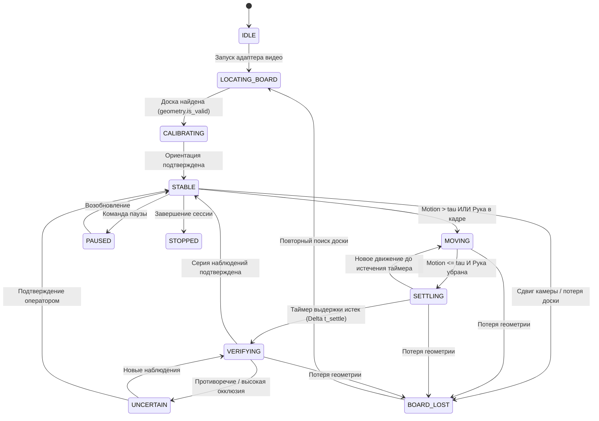

# Проектирование и план реализации: ЭТАП 2 (STAGE/2)

**Тема этапа:** Анализ динамики шахматной сцены: межкадровое движение, детекция кисти руки и маска окклюзии (MediaPipe), конечный автомат FSM с временным дебаунсингом ($\Delta t_{\text{settle}}$) и модуль автоматической разметки датасета (`AutoLabeller`) по эталонной нотации PGN.  
**Ветка реализации:** `STAGE/2`  
**Целевой статус:** От геометрически нормализованного видеопотока ($640 \times 640$) — к безошибочной временной изоляции физического акта совершения хода, фильтрации динамических теней/рук и автоматической генерации свыше 3000 обучающих снимков клеток с одной партии.

---

## 1. Целевое состояние и обоснование архитектурных решений

### 1.1. Назначение и контекст этапа
В соответствии с модульной структурой системы ([ПЗ, подразд. 2.4.2, 2.4.3](file:///home/ectrald/Repos/Chess-game-recording-system/explanatory%20note/sections/sec_designing.tex#L250-L290), [04_VISION_PIPELINE.md](../chess_game_recording_docs/04_VISION_PIPELINE.md) и [05_REASONING_AND_ANALYSIS.md](../chess_game_recording_docs/05_REASONING_AND_ANALYSIS.md)) покадровая независимая классификация шахматной доски неприменима в реальных условиях:
* Рука игрока в момент перемещения фигуры перекрывает поля доски, подменяя реальное изображение фигур текстурой пальцев и рукава;
* При физическом переносе фигура закрывает поля других фигур позади себя по лучу перспективы;
* Лампы освещения отбрасывают от кисти резкие перемещающиеся тени, искажающие яркость пустых клеток и имитирующие появление фигур;
* После установки фигуры на клетку игрок совершает микродвижения пальцев (фаза «поправляю»), а лёгкая фигура испытывает затухающие механические колебания.

Попытка запустить нейросетевой классификатор в произвольный момент времени неизбежно порождает лавину ложных детекций. **Задача второго этапа — построить интеллектуальный временной фильтр и автомат состояний (FSM)**, который:
1. Фиксирует момент появления и исчезновения возмущений;
2. Выдерживает физически обоснованную паузу затухания теней ($\Delta t_{\text{settle}} \in [0{,}5; 1{,}0]$~с);
3. Формирует стабильное наблюдение $O_{t+1}$ только в статический момент времени;
4. Предоставляет инструмент `AutoLabeller` для извлечения тысяч размеченных снимков клеток без участия оператора.

---

### 1.2. Обоснование проектных решений

#### 1. Детекция межкадрового движения в выпрямленном пространстве (Rectified Frame Differencing)
* **Проблема анализа исходного кадра ($1920 \times 1080$):** Движение на заднем плане (проходящие зрители, судьи, жест соперника, нажатие механических шахматных часов сбоку от доски) вызывает срабатывание детектора движения на полном кадре, даже если на самой доске ничего не происходит.
* **Принятое решение (ADR-004):**
  $$\text{Кадр } I_t \xrightarrow{H} \text{Выпрямленная доска } (640 \times 640) \xrightarrow{|I_t^{\text{board}} - I_{t-1}^{\text{board}}|} \text{Маска движения по 64 клеткам}$$
  Детекция движения запускается строго в каноническом нормализованном пространстве $640 \times 640$, полученном на Этапе 1. Вся сцена за пределами внешнего контура доски полностью игнорируется. Детектор возвращает как глобальный уровень движения доски ($M_{\text{global}} \in [0, 1]$), так и вектор поклеточного движения ($M(s) \in [0, 1]$ для всех 64 полей `a1`..`h8`).

#### 2. MediaPipe Hand Landmarker и компенсация оптических теней
* **Роль MediaPipe:** Нейросетевой трекер суставов кисти MediaPipe выдаёт 21 ключевую 3D-точку пальцев и ладони. По этим точкам строится выпуклая оболочка (Convex Hull) руки, которая затем проецируется на плоскость доски через $H_{\text{image} \to \text{board}}$.
* **Косвенные оптические возмущения (проблема теней):** Физическая рука отбрасывает тень, выходящую за пределы анатомического контура кисти. Если ориентироваться только на точки пальцев, клетки под падающей тенью будут ошибочно сочтены статичными и свободными.
* **Принятое решение:**
  1. Выпуклая оболочка руки расширяется адаптивным запасом (Dilation Margin $\approx 15\text{--}25$ px);
  2. MediaPipe выступает **опережающим сенсором блокировки**: при наличии руки в зоне доски переход в фазу стабилизации категорически запрещён;
  3. Для устойчивости к сбоям детектора рук (например, при частичном попадании пальцев в кадр) отсутствие руки валидируется вторым независимым контуром — межкадровой разностью яркости.

#### 3. Конечный автомат FSM с адаптивным окном дебаунсинга ($\Delta t_{\text{settle}}$)
* **Структура состояний:**
  $$\texttt{STABLE} \xrightarrow{\text{движение / рука}} \texttt{MOVING} \xrightarrow{\text{тишина}} \texttt{SETTLING} \xrightarrow{\Delta t_{\text{settle}}} \texttt{VERIFYING} \xrightarrow{\text{согласовано}} \texttt{STABLE}$$
* **Механизм дебаунсинга:**
  - При переходе `MOVING` $\to$ `SETTLING` запускается таймер $\Delta t_{\text{settle}}$ (по умолчанию $0{,}8$~с, т.е. 24 последовательных кадра при 30 FPS);
  - Если в течение этого интервала вновь зафиксировано движение или появилась рука, таймер сбрасывается, а автомат немедленно возвращается в `MOVING`;
  - Переход в `VERIFYING` происходит только тогда, когда сцена оставалась непрерывно неподвижной на протяжении всего окна выдержки;
  - В состоянии `VERIFYING` накапливается серия из $N_{\text{verify}} \ge 5\text{--}10$ последовательных кадров, формируя сглаженное усреднённое наблюдение без дрожания автофокуса.

#### 4. Механизм автоматической нарезки датасета `AutoLabeller`
* **Проблема сбора данных:** Для обучения классификатора фигур (Этап 3) требуется минимум 3000–5000 снимков клеток для каждого нового комплекта фигур и условий освещения. Ручная разметка полигонов 64 клеток на тысячах кадров нереалистична.
* **Принятое решение (ADR-005):**
  - Модуль `AutoLabeller` принимает видеозапись матча (`.mp4`) и нотацию партии (`.pgn`);
  - Виртуальная доска `python-chess` отслеживает точное эталонное состояние на каждом полуходе;
  - Автомат FSM находит точные временные окна стабильности между ходами игроков;
  - В момент подтверждённого состояния `STABLE` нарезаются все 64 поля доски (`CellRoiExtractor`), и каждому полю автоматически присваивается метка класса фигуры (`empty`, `wP`, ..., `bK`);
  - Кадры с смазанным движением или перекрытием руки автоматически отбрасываются;
  - Итог: с одной 60-ходовой партии за несколько минут автоматически формируется свыше $60 \times 2 \times 32 \approx 3840$ эталонно размеченных чистых изображений клеток.

---

## 2. Структура файлов и модулей этапа STAGE/2

```text
Chess-game-recording-system/
├── docs/
│   └── stages/
│       ├── STAGE_0.md
│       ├── STAGE_1.md
│       └── STAGE_2.md                  # Настоящий документ проектирования
├── configs/
│   └── default_config.yaml             # Дополнен секциями motion, hand_detector, labeller
├── src/
│   ├── core/
│   │   ├── __init__.py
│   │   ├── config.py                   # Новые Pydantic-конфиги MotionConfig, HandDetectorConfig
│   │   └── datatypes.py                # FSMState, HandDetection, MotionMetrics, AutoLabellerSample
│   ├── vision/
│   │   ├── __init__.py
│   │   ├── motion_detector.py          # Детектор межкадрового движения в выпрямленном пространстве
│   │   └── hand_detector.py            # Интеграция MediaPipe Hand Landmarker и маска окклюзии
│   ├── reasoning/
│   │   ├── __init__.py
│   │   └── fsm.py                      # Конечный автомат FSM с дебаунсингом и верификацией
│   └── ml/
│       ├── __init__.py
│       └── auto_labeller.py            # Автоматическая нарезка датасета из видео по PGN
└── tests/
    ├── test_motion_detector.py         # Тесты дифференциального движения на синтетике и шумах
    ├── test_hand_detector.py           # Тесты проекции руки, маски окклюзии и fallback-режима
    ├── test_fsm.py                     # Тесты переходов автомата, сброса дебаунсинга и таймеров
    └── test_auto_labeller.py           # Тесты генерации датасета на базе test_short_game.pgn
```

---

## 3. Спецификация контрактов данных и типов (`src/core/datatypes.py`)

### 3.1. Перечисление состояний FSM (`FSMState`)
```python
from enum import Enum

class FSMState(str, Enum):
    """Состояния конечного автомата жизненного цикла регистрации партии."""
    IDLE = "idle"                      # Ожидание инициализации видеопотока
    LOCATING_BOARD = "locating_board"  # Первичный поиск доски в кадре
    CALIBRATING = "calibrating"        # Проверка геометрии и пространственной ориентации
    STABLE = "stable"                  # Сцена статична, позиция зафиксирована
    MOVING = "moving"                  # Зафиксировано движение руки или фигуры
    SETTLING = "settling"              # Движение затихло, выдерживается интервал Delta t_settle
    VERIFYING = "verifying"            # Серия кадров для подтверждения нового наблюдения
    UNCERTAIN = "uncertain"            # Спорная ситуация (высокая окклюзия, конфликт ходов)
    BOARD_LOST = "board_lost"          # Потеря доски / сдвиг камеры
    PAUSED = "paused"                  # Пауза по команде оператора
    STOPPED = "stopped"                # Сессия завершена
```

### 3.2. Метрики движения (`MotionMetrics`)
```python
class MotionMetrics(BaseModel):
    """Результаты дифференциального анализа межкадрового движения."""
    timestamp: float = Field(ge=0.0, description="Временная метка текущего кадра (с)")
    frame_id: int = Field(ge=0, description="Индекс текущего кадра")
    global_motion_score: float = Field(
        ge=0.0, le=1.0,
        description="Доля изменившихся пикселей на выпрямленной доске (0..1)"
    )
    square_motion_scores: Dict[str, float] = Field(
        description="Словарь поклеточных уровней движения для всех 64 полей a1..h8"
    )
    is_motion_detected: bool = Field(
        description="Флаг превышения глобального порога движения tau_motion"
    )
    motion_mask: Optional[np.ndarray] = Field(
        default=None,
        description="Бинарная маска движения 640x640 (uint8)",
        exclude=True,  # Не сериализуется в JSON
    )
```

### 3.3. Результаты детекции кисти руки (`HandDetection`)
```python
class HandLandmark(NamedTuple):
    x: float  # Нормированная координата 0..1
    y: float
    z: float

class HandDetection(BaseModel):
    """Результаты работы детектора кисти руки и маска перекрытия доски."""
    is_hand_present: bool = Field(description="Обнаружена ли рука в рабочей зоне кадра")
    confidence: float = Field(ge=0.0, le=1.0, description="Уверенность детектора кисти")
    landmarks: List[Tuple[float, float, float]] = Field(
        default_factory=list,
        description="21 ключевая точка суставов кисти MediaPipe"
    )
    bounding_box: Optional[Tuple[int, int, int, int]] = Field(
        default=None,
        description="BBox кисти (xmin, ymin, xmax, ymax) в исходном кадре"
    )
    occluded_squares: List[str] = Field(
        default_factory=list,
        description="Список полей a1..h8, перекрытых маской руки"
    )
    occlusion_ratios: Dict[str, float] = Field(
        default_factory=dict,
        description="Степень перекрытия каждого поля маской руки (0.0..1.0)"
    )
```

### 3.4. Метаданные образца датасета (`AutoLabellerSample`)
```python
class AutoLabellerSample(BaseModel):
    """Метаданные одного нарезанного снимка клетки для обучения классификатора."""
    sample_id: str = Field(description="Уникальный идентификатор сэмпла")
    ply_index: int = Field(ge=0, description="Номер полухода партии (0 = старт)")
    square: str = Field(pattern=r"^[a-h][1-8]$", description="Координата поля")
    piece_class: str = Field(description="Класс фигуры (empty, wP, ..., bK)")
    fen_after_ply: str = Field(description="FEN-строка позиции после совершения полухода")
    timestamp_sec: float = Field(ge=0.0, description="Временная метка кадра в секундах")
    image_rel_path: str = Field(description="Относительный путь к сохранённому файлу изображения")
```

---

## 4. Спецификация алгоритмов и программных интерфейсов

### 4.1. Детектор межкадрового движения (`src/vision/motion_detector.py`)

Класс `MotionDetector` работает в выпрямленном пространстве доски ($640 \times 640$):
1. **Препроцессинг:**
   - Перевод выпрямленного кадра в градации серого;
   - Фильтрация Гаусса $k=5, \sigma=1{,}0$ для устранения шумов матрицы сенсора;
   - Нормализация средней яркости: $I_t^{\text{norm}} = I_t \cdot \frac{\mu_{t-1}}{\mu_t}$ (компенсация автоэкспозиции камеры).
2. **Дифференциальная разность:**
   - Попиксельная абсолютная разность: $\Delta I = |I_t^{\text{norm}} - I_{t-1}^{\text{norm}}|$;
   - Бинаризация по порогу чувствительности $\tau_{\text{diff}} \in [15, 35]$;
   - Морфологическое замыкание (`MORPH_CLOSE`, ядро $3 \times 3$) для объединения разрозненных пикселей силуэта руки в сплошную область.
3. **Расчёт метрик:**
   - Глобальный показатель $M_{\text{global}} = \frac{\sum \text{pixels}(\Delta I > \tau_{\text{diff}})}{640 \times 640}$;
   - Поклеточный показатель $M(s) = \frac{\sum_{p \in \text{ROI}(s)} \text{pixels}(\Delta I > \tau_{\text{diff}})}{\text{Area}(\text{ROI}(s))}$;
   - Экспоненциальное сглаживание во времени: $M_{\text{smooth}}^{(t)} = \beta M_{\text{smooth}}^{(t-1)} + (1 - \beta) M_{\text{global}}^{(t)}$ ($\beta \approx 0{,}3$).

```python
class MotionDetector:
    def __init__(self, config: Optional[TemporalConfig] = None) -> None: ...
    def reset(self) -> None: ...
    def process_board_image(
        self,
        board_image_640: np.ndarray,
        frame_id: int,
        timestamp: float,
        rois: Optional[Dict[str, CellROI]] = None,
    ) -> MotionMetrics: ...
```

---

### 4.2. Детектор кисти руки и расчёт окклюзии (`src/vision/hand_detector.py`)

Класс `HandDetector`:
1. **Интеграция с MediaPipe:**
   - При наличии библиотеки `mediapipe` инициализирует `HandLandmarker` в режиме обработки изображений;
   - Если библиотека отсутствует или отключена в конфигурации — бесшовно переходит в `MockHandDetector` (или детектор силуэта телесного цвета в цветовом пространстве YCrCb), предотвращая аварийную остановку в CI/headless-окружениях.
2. **Построение маски перекрытия:**
   - Получение 21 точки суставов обнаруженной кисти в пикселях исходного кадра;
   - Вычисление выпуклой оболочки (`cv2.convexHull`);
   - Морфологическая дилатация полигона с радиусом `dilation_margin` ($15\text{--}20$ px) для учёта объёма пальцев и контактной зоны;
   - Проекция вершин полигона в пространство нормализованной доски через $H_{\text{image} \to \text{board}}$;
   - Растеризация полигона руки на бинарную маску $640 \times 640$.
3. **Расчёт поклеточной окклюзии:**
   - Для каждого поля $s \in \text{CHESS\_SQUARES}$ вычисляется отношение:
     $$\text{occlusion\_ratio}(s) = \frac{\text{Area}(\text{ROI}(s) \cap \text{HandMask})}{\text{Area}(\text{ROI}(s))}$$
   - Если $\text{occlusion\_ratio}(s) \ge \tau_{\text{occlusion}}$ (по умолчанию $0{,}15$), поле получает статус `occluded = True`.

```python
class HandDetector:
    def __init__(self, config: Optional[VisionConfig] = None) -> None: ...
    def detect(
        self,
        frame: Frame,
        geometry: Optional[BoardGeometry] = None,
        rois: Optional[Dict[str, CellROI]] = None,
    ) -> HandDetection: ...
```

---

### 4.3. Конечный автомат FSM с дебаунсингом (`src/reasoning/fsm.py`)

Класс `GameFSM` реализует точную логику автомата из [ПЗ, подразд. 2.4.3](file:///home/ectrald/Repos/Chess-game-recording-system/explanatory%20note/sections/sec_designing.tex#L270-L285):



**Инварианты работы автомата:**
* **`STABLE`:** Вход в распознавание нового хода заблокирован до появления возмущений;
* **`MOVING`:** Принятие ходов строго запрещено; накапливаются доказательные кадры движения;
* **`SETTLING`:** Таймер с непрерывным отсчётом времени в секундах (по timestamp кадра, что делает FSM независимым от переменного FPS видеофайла). Любой всплеск движения сбрасывает счётчик;
* **`VERIFYING`:** Буферизуется $N_{\text{verify}}$ последовательных наблюдений (`BoardObservation`). Если все $N_{\text{verify}}$ наблюдений дают согласованную топологию изменений — генерируется сигнал подтверждения хода `ON_SETTLED_OBSERVATION`.

---

### 4.4. Модуль автоматической нарезки датасета `AutoLabeller` (`src/ml/auto_labeller.py`)

Класс `AutoLabeller`:
1. Загружает видеозапись через `create_video_adapter` и PGN-файл через `chess.pgn`;
2. Инициализирует шахматную доску `chess.Board()`;
3. В цикле обрабатывает кадры потока связкой:
   `Localizer` $\to$ `GeometryTransformer` $\to$ `MotionDetector` $\to$ `HandDetector` $\to$ `GameFSM`;
4. При каждом переходе `VERIFYING` $\to$ `STABLE`:
   - Сопоставляет текущий стабильный момент с очередным полуходом PGN;
   - Проверяет, что на кадре полностью отсутствует смаз движения и рука (`hand_present = False`);
   - Для всех 64 клеток через `CellRoiExtractor` нарезает выпрямленные изображения $112 \times 112$;
   - Извлекает класс фигуры на каждой клетке из `chess.Board.piece_at(square)`:
     - `None` $\to$ класс `empty`;
     - `chess.Piece` $\to$ `wP`, `wN`, `wB`, `wR`, `wQ`, `wK`, `bP`, ..., `bK`;
   - Сохраняет изображения в структурированный каталог по классам:
     `data/dataset/train/{piece_class}/{ply:04d}_{square}_{timestamp:.2f}.png`;
   - Добавляет запись в манифест `data/dataset/dataset_manifest.json`;
   - Выполняет ход `board.push(move)`.
5. По завершении формирует итоговый отчёт: количество сэмплов по каждому из 13 классов, общее время обработки, баланс классов.

---

## 5. Обновление конфигурации (`configs/default_config.yaml` и `src/core/config.py`)

Секция `temporal` и `vision` в `configs/default_config.yaml` расширяются новыми параметрами:

```yaml
temporal:
  settling_time_sec: 0.8          # Delta t_settle: Окно дебаунсинга в секундах
  motion_diff_threshold: 0.04     # tau_motion: Порог доли изменившихся пикселей для входа в MOVING
  verifying_stable_frames: 8      # N_verify: Количество стабильных кадров для перехода в STABLE
  pixel_diff_threshold: 25        # tau_diff: Чувствительность межкадровой разности яркости (0..255)
  motion_ema_alpha: 0.35          # Коэффициент экспоненциального сглаживания движения

vision:
  hand_detector:
    enabled: true
    min_detection_confidence: 0.60
    min_tracking_confidence: 0.50
    dilation_margin_px: 18        # Запас расширения полигона руки для покрытия теней
    occlusion_threshold: 0.15     # Доля перекрытия поля рукой для установки occluded=True

labeller:
  output_dir: "data/dataset"
  target_crop_size: [112, 112]
  max_samples_per_move: 64
  save_format: "png"
```

---

## 6. Комплексный план тестирования для STAGE/2

| Тестовый модуль | Проверяемый функционал | Критерий успешности |
| :--- | :--- | :--- |
| `tests/test_motion_detector.py` | 1. Нулевое движение на серии статичных кадров.<br>2. Резкий скачок $M_{\text{global}}$ при появлении перемещающейся фигуры.<br>3. Локализация движения строго на полях отправления и назначения.<br>4. Устойчивость к глобальному изменению освещённости кадра. | $M_{\text{static}} < 0{,}01$; $M_{\text{move}} > 0{,}05$; поля $s_{\text{from}}, s_{\text{to}}$ имеют максимальные $M(s)$. |
| `tests/test_hand_detector.py` | 1. Работа детектора при наличии руки в кадре.<br>2. Проекция полигона руки в координаты доски через гомографию.<br>3. Корректность выставления флага `occluded=True` для перекрытых полей.<br>4. Безошибочный fallback при отсутствии MediaPipe. | Маска перекрытия совпадает с положением руки; перекрытые поля получают `occluded=True`. |
| `tests/test_fsm.py` | 1. Полный цикл `STABLE` $\to$ `MOVING` $\to$ `SETTLING` $\to$ `VERIFYING` $\to$ `STABLE`.<br>2. Сброс таймера $\Delta t_{\text{settle}}$ при повторном движении.<br>3. Корректность перехода в `BOARD_LOST` при сбоях геометрии.<br>4. Нечувствительность к переменной частоте кадров (отсчёт по timestamp). | Состояния переключаются строго по спецификации; дребезг нейтрализуется. |
| `tests/test_auto_labeller.py` | 1. Сквозная авторазметка тестовой синтетической партии `test_short_game.pgn`.<br>2. Корректность классов нарезанных клеток (соответствие FEN позиции).<br>3. Полное отсутствие размытых кадров из фазы движения.<br>4. Формирование валидного манифеста `dataset_manifest.json`. | Сгенерировано $\ge 400$ размеченных снимков клеток (на 7 полуходах); 100% точность меток классов. |

---

## 7. Критерии приёмки (Definition of Done) этапа STAGE/2

Этап `STAGE/2` считается завершённым при выполнении следующих требований:

1. [x] Реализованы контракты `FSMState`, `HandDetection`, `MotionMetrics`, `AutoLabellerSample` в `src/core/datatypes.py`.
2. [x] Дополнены конфигурационные модели `TemporalConfig` и `VisionConfig` параметрами детектора движения, маски руки и авторазметчика в `src/core/config.py` и `configs/default_config.yaml`.
3. [x] Реализован детектор межкадрового движения в выпрямленном пространстве $640 \times 640$ (`src/vision/motion_detector.py`).
4. [x] Реализован детектор руки и построитель полигональной маски окклюзии (`src/vision/hand_detector.py`) с поддержкой MediaPipe и fallback-режима.
5. [x] Реализован конечный автомат жизненного цикла партии `GameFSM` (`src/reasoning/fsm.py`) с окном дебаунсинга $\Delta t_{\text{settle}} \in [0{,}5; 1{,}0]$~с и верификацией серии стабильных кадров.
6. [x] Реализован конвейер автоматической нарезки и разметки датасета `AutoLabeller` (`src/ml/auto_labeller.py`) на базе эталонных нотаций PGN.
7. [x] Реализован полный набор тестов (`tests/test_motion_detector.py`, `tests/test_hand_detector.py`, `tests/test_fsm.py`, `tests/test_auto_labeller.py`).
8. [x] Проведена генерация тестового датасета клеток на базе синтетической последовательности Stage 0: проверено отсутствие смазанных кадров и корректность меток 13 классов.
9. [x] Полный комплекс тестов `pytest tests/` (Этап 0 + Этап 1 + Этап 2) выполняется на 100% без ошибок.
10. [x] Проектный документ этапа синхронизирован с проектной документацией и пояснительной запиской.

