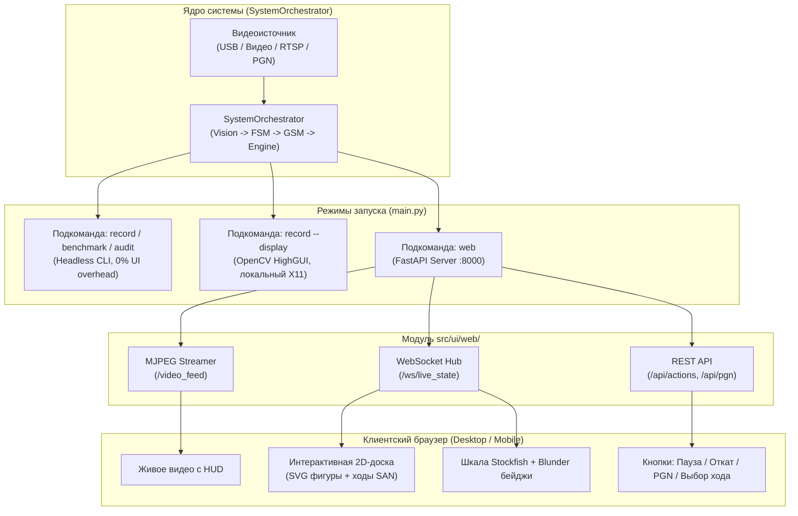

# Проектирование и план реализации: ЭТАП 7 (STAGE/7) — Web-интерфейс и многопрофильная контейнеризация

**Тема этапа:** Разработка независимого веб-интерфейса (FastAPI + WebSocket + MJPEG видеопоток + HTML5/CSS/JS интерактивная доска), реализация подкоманды `web` в CLI, разграничение профилей запуска в Docker (легковесный CLI для слабых машин vs полнофункциональный Web UI) и комплексное приёмо-сдаточное тестирование.  
**Ветка реализации:** `STAGE/7`  
**Целевой статус:** Предоставление пользователю гибкого выбора способа эксплуатации:
1. Автономный консольный режим (`CLI`) с околонулевым оверхедом по памяти и CPU;
2. Настольный режим (`OpenCV HighGUI`) с локальным окном X11;
3. Кроссплатформенный веб-интерфейс (`Web UI`), доступный с любого устройства в локальной сети (ПК, ноутбук, планшет, смартфон) через стандартный браузер без проброса графических серверов из Docker.

---

## 1. Целевое состояние и обоснование архитектурных решений

### 1.1. Проблема и мотивация
На Этапе 6 был реализован графический интерфейс на базе OpenCV HighGUI. Несмотря на высокую производительность при локальном запуске, данный подход имеет существенные ограничения в сценариях контейнеризации и мобильного использования:
1. **Сложность проброса дисплея из Docker:** на хостах Windows (WSL2/WSLg) и macOS (XQuartz) проброс сокетов X11 требует от пользователя глубоких настроек прав доступа, установки сторонних X-серверов и часто приводит к ошибкам авторизации (`cannot open display :0`);
2. **Локальная привязка к монитору:** экран оператора можно просматривать только на мониторе того компьютера, к которому физически подключена камера;
3. **Разделение вычислительных профилей (User Stories):**
   * *Сценарий А (Слабый ПК / Сервер / Edge-устройство):* пользователю нужна пакетная обработка видеозаписей, бенчмаркинг или генерация PGN без накладных расходов веб-сервера и GUI.
   * *Сценарий Б (Обычный пользователь с веб-камерой и ноутбуком):* пользователю нужен удобный визуальный контроль с красивой шахматной доской, шкалой Stockfish и кнопками отката ходов прямо в браузере по адресу `http://localhost:8000`.

### 1.2. Архитектурное решение: Независимый веб-контур поверх `SystemOrchestrator`



### 1.3. Принцип разграничения Docker-контейнеров
Чтобы не нагружать слабые компьютеры ненужными службами и не требовать от пользователя запуска веб-сервера, когда нужен только CLI, вводится следующая архитектура контейнеризации:

1. **Единый базовый Docker-образ (`chess-recorder:latest`):**
   * Содержит Python 3.11, оптимизированный инференс ONNX Runtime, движок Stockfish 16 и легковесный FastAPI;
   * Точка входа по умолчанию: `ENTRYPOINT ["python", "main.py"]`.
2. **Многопрофильная конфигурация `docker-compose.yml`:**
   * **Профиль `chess-recorder-cli` (Минимальный footprint):**
     * Никаких открытых портов;
     * Никаких веб-серверов в памяти;
     * Запуск чистого пакетного конвейера, бенчмарка или аудита;
     * Минимальное потребление ОЗУ (<150 МБ).
   * **Профиль `chess-recorder-web` (Web UI):**
     * Проброс порта `8000:8000`;
     * Примонтированные каталоги `./data/sessions` и `./configs`;
     * Запуск `python main.py web --host 0.0.0.0 --port 8000`;
     * Доступность в браузере хоста по адресу `http://localhost:8000`.
   * **Профиль `chess-recorder-gui` (X11):**
     * Для продвинутых пользователей Linux с локальным X-сервером.

---

## 2. Структура файлов и модулей этапа STAGE/7

```text
Chess-game-recording-system/
├── Dockerfile                              # Мультиплатформенный образ (Python 3.11 + Stockfish + Web)
├── docker-compose.yml                      # Профили запуска: chess-recorder-web, chess-recorder-cli
├── main.py                                 # Точка входа с добавленной подкомандой `web`
├── configs/
│   └── default_config.yaml                 # Секция web_ui (хост, порт, fps стрима)
├── docs/stages/
│   └── STAGE_7_WEB_UI.md                   # Настоящий документ спецификации
├── src/
│   ├── core/
│   │   └── config.py                       # Модель конфигурации WebUIConfig
│   └── ui/
│       ├── __init__.py                     # Экспорт Web-модулей
│       ├── cli.py                          # Регистрация подкоманды `web`
│       └── web/                            # Пакет веб-сервера
│           ├── __init__.py                 # Инициализация пакета
│           ├── app.py                      # FastAPI приложение, роутеры и lifecycle
│           ├── streamer.py                 # Генератор потокового MJPEG-видео
│           ├── ws_manager.py               # Менеджер WebSocket-подключений и рассылки событий
│           ├── static/                     # Статические файлы (CSS, JS, SVG фигуры)
│           │   ├── css/
│           │   │   └── style.css           # Современные адаптивные стили (Dark Theme)
│           │   ├── js/
│           │   │   └── app.js              # WebSocket-клиент, рендер доски, кнопки управления
│           │   └── img/                    # SVG-спрайты шахматных фигур
│           └── templates/
│               └── index.html              # Главная страница оператора
└── tests/
    └── test_web_ui.py                      # Тестирование REST эндпоинтов, WebSocket и видеопотока
```

---

## 3. Спецификация контрактов и программных интерфейсов Web UI

### 3.1. Конфигурация веб-сервера (`WebUIConfig`)

В [src/core/config.py](file:///home/ectrald/Repos/Chess-game-recording-system/src/core/config.py) добавляется секция:

```python
class WebUIConfig(BaseModel):
    """Конфигурация веб-сервера и браузерного интерфейса."""
    enabled: bool = Field(default=True, description="Доступность веб-интерфейса")
    host: str = Field(default="0.0.0.0", description="IP-адрес для прослушивания")
    port: int = Field(default=8000, ge=1024, le=65535, description="Сетевой порт HTTP/WebSocket")
    stream_fps: float = Field(default=25.0, ge=5.0, le=60.0, description="Частота кадров MJPEG-потока")
    jpeg_quality: int = Field(default=80, ge=30, le=100, description="Качество сжатия JPEG для видеострима")
    cors_origins: List[str] = Field(default_factory=lambda: ["*"], description="Разрешенные CORS-источники")
```

### 3.2. Спецификация REST API и WebSocket-протокола

| Эндпоинт | Метод | Описание | Формат данных |
| :--- | :---: | :--- | :--- |
| `/` | `GET` | Главная страница оператора | HTML5 + CSS + JS |
| `/video_feed` | `GET` | Видеопоток камеры с наложенным HUD | `multipart/x-mixed-replace; boundary=frame` (MJPEG) |
| `/ws/live` | `WebSocket` | Двусторонний канал реального времени | JSON сообщения (`LiveStateUpdate`, `UserAction`) |
| `/api/state` | `GET` | Мгновенный снимок `PipelineState` | JSON (`PipelineState`) |
| `/api/pgn` | `GET` | Текущий канонический текст PGN партии | Текстовый файл `game.pgn` (`text/plain`) |
| `/api/action/pause` | `POST` | Переключение режима Пауза/Возобновление | JSON `{"is_paused": bool}` |
| `/api/action/rollback`| `POST` | Откат последнего хода (Undo) | JSON `{"rolled_back_move": "e2e4"}` |
| `/api/action/recalibrate`| `POST` | Запрос принудительной рекалибровки доски | JSON `{"status": "ok"}` |
| `/api/action/resolve` | `POST` | Разрешение неопределенности `UNCERTAIN` | JSON `{"candidate_index": int}` или `{"move_uci": str}` |

### 3.3. Структура WebSocket сообщений (`/ws/live`)

Сервер в реальном времени рассылает клиентам JSON-события при каждом шаге конвейера:

```json
{
  "type": "state_update",
  "data": {
    "frame_id": 450,
    "timestamp": 15.0,
    "fsm_state": "STABLE",
    "board_detected": true,
    "current_ply": 4,
    "current_fen": "r1bqkbnr/pppp1ppp/2n5/4p3/4P3/5N2/PPPP1PPP/RNBQKB1R w KQkq - 2 3",
    "last_move": {
      "san": "Nc6",
      "uci": "b8c6",
      "ply": 4
    },
    "engine_eval": {
      "score_cp": 35,
      "mate_in": null,
      "best_move": "d2d4",
      "quality": "best"
    },
    "uncertainty": {
      "active": false,
      "candidates": []
    },
    "telemetry": {
      "fps": 29.8,
      "motion_level": 0.012,
      "hand_detected": false
    }
  }
}
```

---

## 4. Архитектура фронтенда и эргономика рабочего места

Фронтенд проектируется как легковесный автономный SPA (Single Page Application) без необходимости сборки Webpack/Node.js, что гарантирует мгновенный запуск прямо из Python/Docker:

1. **Видеоканал (Left Pane):**
   * Элемент `` с динамической адаптацией под размер экрана;
   * Наложенный индикатор состояния FSM (цветовой бейдж в углу видео).
2. **Интерактивная доска (Right Top Pane):**
   * Отрисовка клеток доски на чистом HTML5 Canvas или SVG-разметке с высококачественными векторными фигурами;
   * Автоматическая подсветка полей последнего хода (зелёный/бирюзовый) и стрелка хода;
   * Плавная анимация при обновлении FEN через WebSocket.
3. **Панель аналитики Stockfish (Right Middle Pane):**
   * Плавный динамический индикатор преимущества (Progress Bar от чёрного к белому);
   * Отображение численной оценки (например, $+0{,}45$ или $M3$) и подсказка лучшего хода.
4. **История ходов (Right Bottom Pane):**
   * Таблица ходов с разделением по белым и чёрным;
   * Цветные бейджи качества: `[BEST]`, `[GOOD]`, `[INACCURACY]`, `[BLUNDER]`.
5. **Панель управления оператора:**
   * Кнопки: «Пауза / Продолжить», «Откат хода», «Калибровка», «Скачать PGN»;
   * Всплывающий модальный диалог при состоянии `UNCERTAIN` с карточками ходов-кандидатов и кнопками подтверждения в один клик.

---

## 5. План реализации по шагам

| Шаг | Наименование | Содержание работ |
| :---: | :--- | :--- |
| **1** | Зависимости и конфигурация | Добавление `fastapi>=0.110.0` и `uvicorn>=0.28.0` в `requirements.txt`. Добавление `WebUIConfig` в `src/core/config.py` и `configs/default_config.yaml`. |
| **2** | WebSocket Hub и Streamer | Реализация `src/ui/web/ws_manager.py` (потокобезопасная рассылка сообщений подписчикам) и `src/ui/web/streamer.py` (MJPEG генератор кадров с HUD из `VisualHUDComposer`). |
| **3** | FastAPI Бэкенд и REST API | Реализация `src/ui/web/app.py`: инициализация приложения, маршруты `/video_feed`, `/api/state`, `/api/pgn`, обработчики действий оператора (`pause`, `rollback`, `resolve`). |
| **4** | Фронтенд (HTML5/CSS/JS) | Создание адаптивного шаблона `src/ui/web/templates/index.html`, стилей `style.css` (Dark Theme) и клиентского скрипта `app.js` с рендерингом шахматной доски и WebSocket-синхронизацией. |
| **5** | Интеграция в CLI (`main.py`) | Добавление подкоманды `web` в `src/ui/cli.py` (`python main.py web --source 0 --host 0.0.0.0 --port 8000`). Запуск Uvicorn-сервера с передачей сконфигурированного `SystemOrchestrator`. |
| **6** | Контейнеризация и Docker Compose | Обновление `docker-compose.yml`: чёткое разделение сервисов `chess-recorder-web` (порт 8000) и `chess-recorder-cli` (headless без веб-сервера). Обновление `Dockerfile`. |
| **7** | Комплексное тестирование | Разработка тестов `tests/test_web_ui.py`: тестирование REST-эндпоинтов, стриминга MJPEG, WebSocket-подключений и обработки действий оператора через FastAPI TestClient. |
| **8** | Обновление документации | Фиксация инструкций по запуску Web UI в [README.md](file:///home/ectrald/Repos/Chess-game-recording-system/README.md). |

---

## 6. Критерии приёмки (Definition of Done) этапа STAGE/7

Этап считается завершённым при выполнении следующих требований:

1. [x] В `requirements.txt` добавлены легковесные зависимости `fastapi` и `uvicorn`.
2. [x] В `src/core/config.py` и `configs/default_config.yaml` добавлена валидируемая секция `web_ui`.
3. [x] Реализован асинхронный сервер `src/ui/web/app.py`, стример видео `streamer.py` и менеджер `ws_manager.py`.
4. [x] Разработан современный адаптивный веб-интерфейс (HTML5 / CSS / Vanilla JS) с отображением живого видео, векторной доски, оценки Stockfish и диалога `UNCERTAIN`.
5. [x] Добавлена и протестирована консольная команда `python main.py web` с аргументами `--host`, `--port`, `--source`.
6. [x] Обновлен `docker-compose.yml`: реализованы независимые профили `chess-recorder-web` (для браузерной работы) и `chess-recorder-cli` (для экономии ресурсов на слабых машинах).
7. [x] Разработан тестовый набор `tests/test_web_ui.py` с проверкой API, WebSocket и генератора видеопотока.
8. [x] Все тесты проекта (`pytest tests/`, Этапы 0–7) выполняются на 100% без ошибок (241 passed).
9. [x] Обновлены инструкции в [README.md](file:///home/ectrald/Repos/Chess-game-recording-system/README.md).
